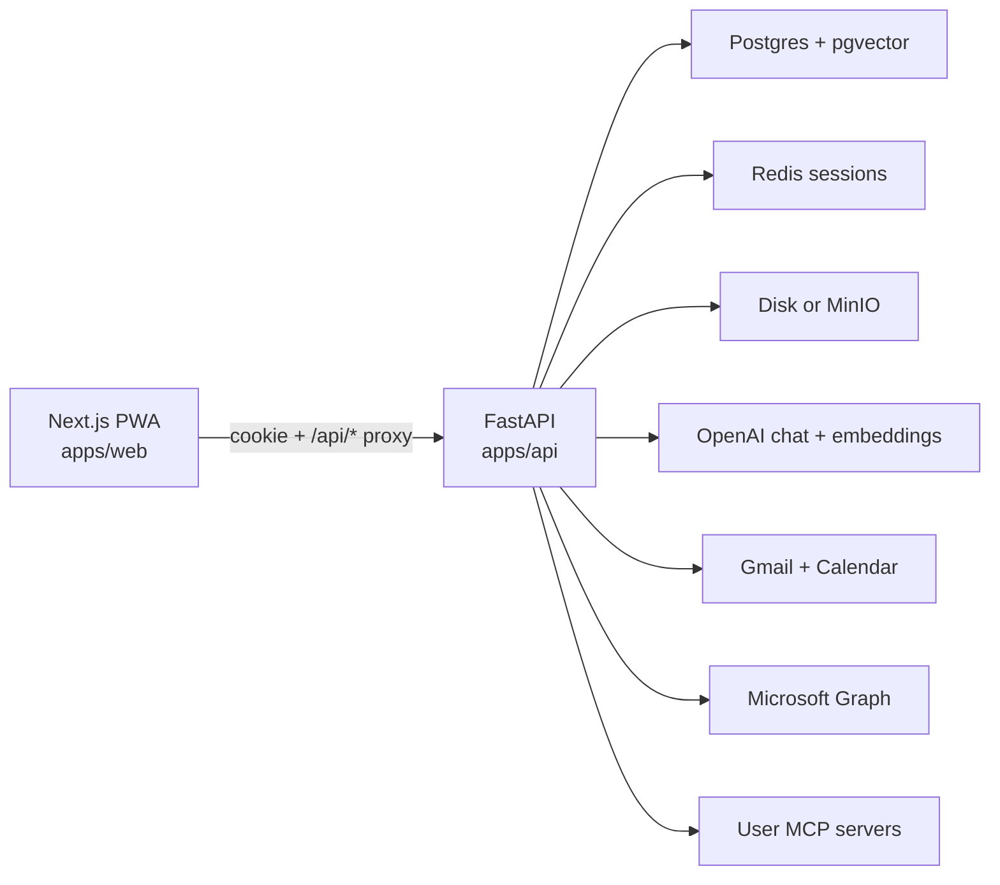

# Checkme — Assistant Workspace

Personal chief-of-staff for **mail, calendar, files, and connected MCP systems**. Sign in with Google or Microsoft. That sign-in attaches Gmail or Outlook (mail + calendar). Add more MCP servers on the Connectors page. Chat never loads every tool into the model: it lists your connectors, searches the catalog, then calls one tool at a time.

Design docs:

- [High-level design (HLD)](docs/HLD.md) — system context, components, end-to-end flows
- [Low-level design (LLD)](docs/LLD.md) — modules, APIs, data model, sequences
- [Architecture diagrams](docs/diagrams.md) — Mermaid context, containers, sequences, ERD

## What you can do

| Surface | What it does |
| --- | --- |
| **Chat** | Ask about mail, calendar, attachments, or any connected MCP. Open threads, summarize, send (with in-app confirm, including **Cc/Bcc**), schedule later work. **See full email** on mail answers. |
| **Agents and groups** | Create persistent specialists, give each private instructions and skills, then run group work in a shared thread with explicit handoffs between agents. |
| **Inbox** | Background ingest of Gmail/Outlook **To and Cc** (Bcc when the mailbox exposes it). Newest 40 pending cards. Classify reply / respond / discard, draft a thread-aware reply, rephrase, attach files, add **Cc/Bcc/Reply all**, send, or delete. **See full email** on every summary. |
| **Connectors** | Link the other mailbox, or add an MCP URL (OAuth, bearer, or none). |
| **Tasks** | One-shot or recurring jobs the scheduler runs even when you are logged out. |

Notifications use a red bell, including mail where you are on **Cc**. New mail is ingested by an API worker (no browser session required). The inbox list stays at 40 cards: older pending cards are dropped in-app when newer mail arrives. Chief-of-staff briefing covers CC’d mail in its own section.

## Architecture (snapshot)



- **`apps/web`** — Next.js 15 PWA. Browser talks only to same-origin `/api/*`; Next proxies to FastAPI and forwards the session cookie.
- **`apps/api`** — Auth, chat agent, inbox worker, task scheduler, file storage, connector runtime.
- **`packages/gmail_mcp`**, **`packages/outlook_mcp`**, **`packages/connector_core`** — Shared mail/calendar tool names; in-process connectors (and optional stdio MCP servers for Cursor).

## Branches

- **`local`** — machine development. Run with Docker Compose below.
- **`main`** — Render deploys from this branch. Blueprint: [`render.yaml`](render.yaml).

## Repo layout

```
apps/web          Next.js PWA (chat, inbox, connectors, tasks)
apps/api          FastAPI, agent, OAuth, workers
packages/connector_core   Shared ToolSpec, mail/calendar catalog, text helpers
packages/gmail_mcp        Gmail + Google Calendar connector
packages/outlook_mcp      Microsoft Graph mail + calendar connector
deploy/postgres           Render Postgres image with pgvector
```

## Run locally

1. Copy [`.env.example`](.env.example) to `.env`.
2. Generate secrets:

```bash
python3 -c "import secrets; print('SESSION_SECRET=' + secrets.token_urlsafe(48))"
python3 -c "from cryptography.fernet import Fernet; print('TOKEN_ENCRYPTION_KEY=' + Fernet.generate_key().decode())"
```

3. Set `OPENAI_API_KEY`. Do not commit `.env`.
4. Google OAuth **Web** client. Redirect URI: `http://localhost:3000/api/auth/google/callback`.
5. Microsoft Entra app (any org + personal accounts). Redirect URI: `http://localhost:3000/api/auth/microsoft/callback`. Enable the Graph scopes listed in [HLD](docs/HLD.md#oauth-scopes).
6. Start:

```bash
docker compose up --build
```

Open [http://localhost:3000](http://localhost:3000). API is `localhost:8001` inside Compose (`8000` in the container). Optional Letta memory: `docker compose --profile letta up`.

API tests (from `apps/api`):

```bash
.venv/bin/python -m pytest -q
```

## Deploy on Render (`main`)

1. Push `main` to GitHub.
2. In Render: **New → Blueprint**, repo, branch `main`.
3. Fill secrets: `OPENAI_API_KEY`, Google and Microsoft OAuth client values. Put OAuth and OpenAI on **checkme-api**, not only the env group.
4. After first deploy, copy the `checkme-web` URL.
5. Add that origin as an OAuth redirect:
   - Google: `{PUBLIC_WEB_URL}/api/auth/google/callback`
   - Microsoft: `{PUBLIC_WEB_URL}/api/auth/microsoft/callback`

`TOKEN_ENCRYPTION_KEY` and `SESSION_SECRET` are generated by Render. Attachments on Render use a disk on `checkme-api` (`FILE_STORAGE=disk`). MinIO is local-only.

## Sign-in

- **Continue with Google** → built-in `gmail` connector (Gmail + Calendar + Meet).
- **Continue with Microsoft** → built-in `outlook` connector (Graph mail + Calendar + Teams).
- **Connectors** → link the other mailbox, or add an MCP URL.

Refresh tokens are stored encrypted per account (`TOKEN_ENCRYPTION_KEY`). The web app does not put provider tokens in the browser.

## Mail and calendar tools

Gmail and Outlook expose the **same tool names** (`list_messages`, `get_thread`, `send_message`, `reply`, `create_event`, `empty_folder`, …). Chat discovers them with `list_connectors` → `search_tools` → `get_tool_schema` → `call_tool`. Destructive sends, deletes, and meeting creates wait for an in-app Confirm button.

`list_messages` returns inbox mail on **To or Cc**, each row tagged `recipient_role` (`to` | `cc` | `bcc`). `send_message` and `reply` accept extra `cc` / `bcc` (and `reply_all` on reply). Opening or summarizing mail loads the **full thread** (Outlook `conversationId` / Gmail `threadId`), not only the latest reply. Inbox and chat both offer **See full email**.

Standalone MCP (`gmail-mcp`, `outlook-mcp`) for Cursor needs a refresh token in the environment. This web app stores tokens encrypted per user instead.

## Agents, groups, and reusable skills

Each agent has its own instructions, memory, connector access, and skills. On a new agent's first chat, choose a focus to see starter prompts for useful recurring work. Selecting a prompt sends it to the agent; it does not start running until you choose it. You can also attach a starter skill while creating the agent, save one later from its profile, or teach a workflow by demonstrating it on the computer. Matching skills are loaded into that agent's prompt on later turns.

Create a group from two to six agents and describe the outcome it should finish. In the group's chat, **Start the group's outcome** kicks off that work with the selected owner. Agents can hand stages to teammates with `ask_teammate`, and each teammate replies under its own name in the shared thread. Scheduled runs keep recurring agents active in the background; sensitive external actions still use the existing confirmation flow.

### Webhook automations

Ask an agent to create a webhook automation and specify the event name, condition, action, and (optionally) the agent that should run it. The automation returns a webhook URL and one-time secret. Send the secret in `X-Checkme-Secret`, the exact configured event in `X-Event-Type`, and a stable delivery id in `Idempotency-Key`. Webhook payloads are treated as untrusted event data; they cannot override the agent's instructions. External actions require approval by default.

```bash
curl -X POST 'https://YOUR_CHECKME/api/webhooks/AUTOMATION_ID' \
  -H 'Content-Type: application/json' \
  -H 'X-Checkme-Secret: ONE_TIME_SECRET' \
  -H 'X-Event-Type: issues' \
  -H 'Idempotency-Key: github-delivery-id' \
  -d '{"action":"opened","issue":{"number":42,"title":"Fix login"}}'
```

Create and manage hooks through the authenticated API at `POST /api/automations/webhooks`, `GET /api/automations`, `PATCH /api/automations/{id}`, and `DELETE /api/automations/{id}`. The secret is stored as a SHA-256 hash and cannot be retrieved after creation. Repeated deliveries with the same idempotency key are accepted without starting another job.

### Agent memory and personalization

Each agent keeps its own learned preferences and recent-work memory. In chat, tell an agent “remember that…” to save a durable preference; agents avoid storing passwords, API keys, tokens, or recovery codes. Open an agent's **Edit Profile** panel and expand **What this agent remembers** to review its saved context. The authenticated `GET /api/agents/{agent_id}/memory` endpoint returns that same agent's memory only. Agents can also be trained through chat by asking them to change their role or instructions; they may suggest a schedule or webhook when repeated requests would benefit from proactive follow-through.
