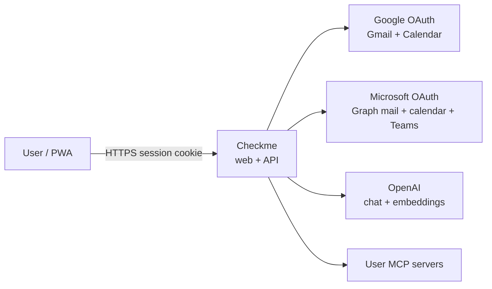
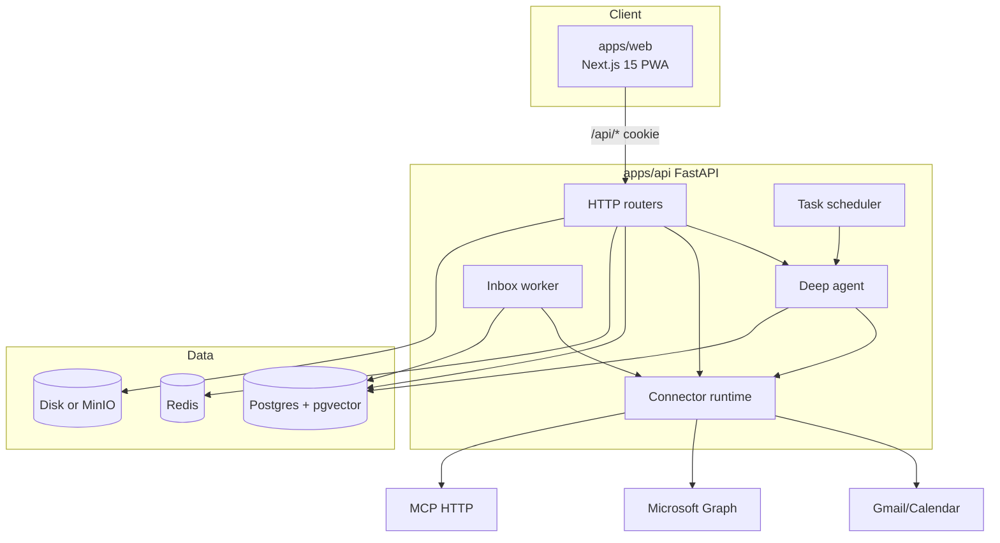
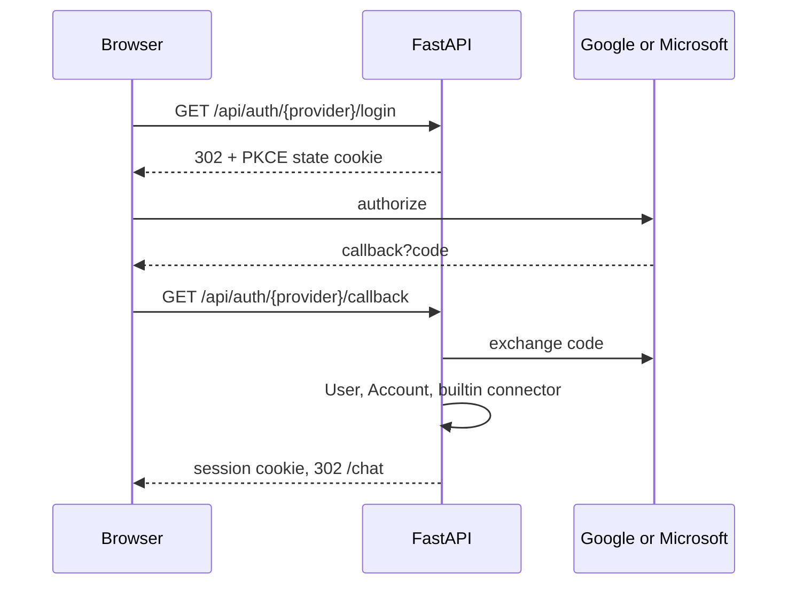
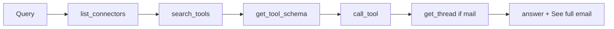
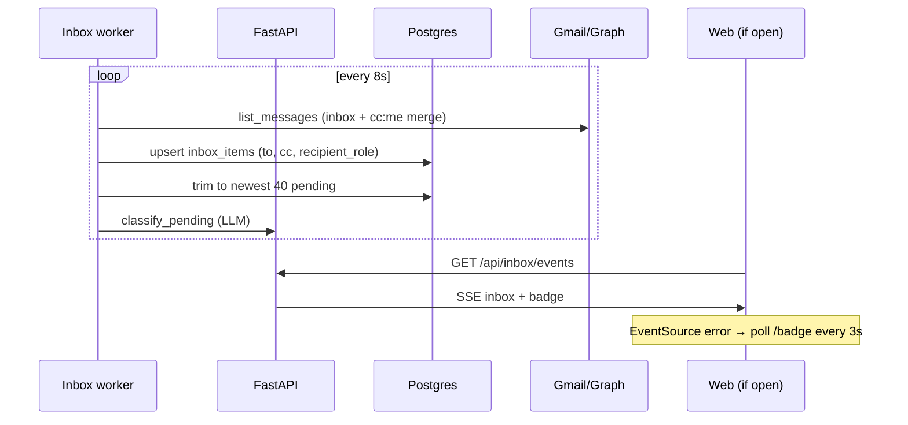
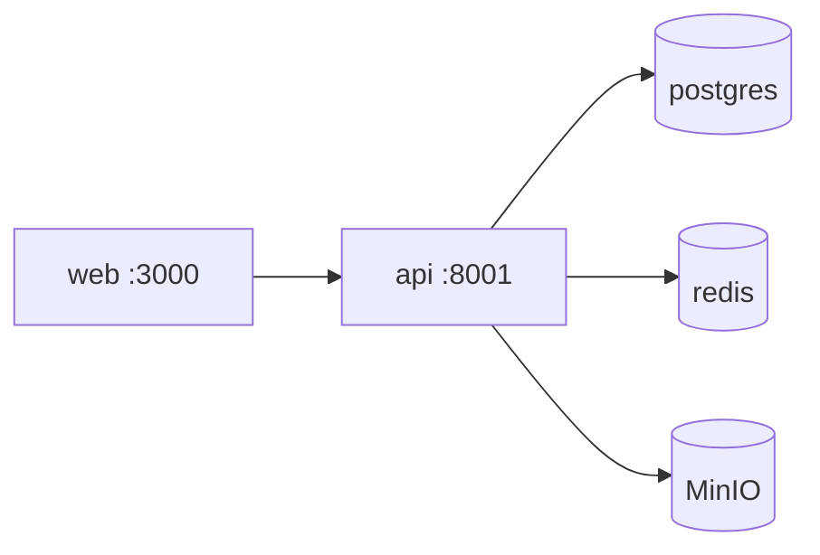

# High-level design

End-to-end architecture of Checkme (Assistant Workspace): a signed-in PWA that acts as chief of staff over Gmail, Outlook, calendar, files, and user-added MCP servers.

Related: [README](../README.md) · [LLD](LLD.md) · [Diagrams](diagrams.md)

## 1. Purpose

Give one person a private workspace that can:

1. Read and act on **mail and calendar** from Google and/or Microsoft.
2. **Triage inbound mail** in the background — including messages where the user is on **Cc or Bcc** — and draft thread-aware replies (optional extra Cc/Bcc on send).
3. Answer questions in **chat** using only that user’s connectors (builtin mail plus optional MCP).
4. **Schedule work** for later without an open browser.
5. Keep provider tokens and attachments **off the model** except as extracted text the user asked to use.

Non-goals (not in this codebase today): CSE / S/MIME, IMAP-POP import, Gmail history-id push, multi-tenant orgs, public sharing of chats.

## 2. Actors and use cases

| Actor | Use cases |
| --- | --- |
| End user | Sign in, chat, triage inbox (To and Cc), send/rephrase with optional Cc/Bcc, attach files, connect MCP, schedule tasks |
| Background workers | Ingest mail every ~8s, classify pending cards, run due scheduled tasks |
| Identity providers | Google and Microsoft OAuth (sign-in + mail/calendar consent) |
| LLM provider | OpenAI chat completions and embeddings |
| MCP servers | Optional third-party tools (sales KPIs, internal APIs) |

Primary journeys:

- Sign in → land on Chat.
- “Open this mail thread …” → search → full `get_thread` → optional attachment summary → **See full email**.
- New mail arrives while logged out (To or Cc) → worker stores a card → bell + Inbox (max 40 pending).
- Send from Inbox → optional Cc, Bcc, Reply all on the drafted reply.
- “Empty spam” / send / meeting invite → tool call → Confirm UI → execute.
- “Email me this report in 20 minutes” → `schedule_task` → scheduler runs the agent later.

## 3. System context

The browser never calls Gmail, Graph, or OpenAI directly. Next.js is a same-origin reverse proxy; FastAPI holds tokens and runs tools.

## 4. Containers

| Container | Responsibility |
| --- | --- |
| `apps/web` | UI (chat, inbox, connectors, tasks), PWA shell, SSE EventSource, file upload, attachment preview |
| `apps/api` | Session auth, agent loop, inbox ingest/classify, scheduler, file I/O, OAuth |
| Postgres | Users, accounts, connectors, chats, inbox cards, tools index, tasks |
| Redis | Session presence, revocation, rate limits |
| Object storage | Uploaded and mail attachments. Local: MinIO. Render: disk on `checkme-api` |
| Packages | `connector_core` catalog; `gmail_mcp` / `outlook_mcp` implementations |

## 5. Web application surfaces

| Route | Role |
| --- | --- |
| `/` | Google / Microsoft sign-in. Redirects to `/chat` if already signed in |
| `/chat` | Transcript, composer, attach, confirm destructive tools, **See full email** |
| `/inbox` | Triage cards (Cc’d-to-you badge), drafts, Cc/Bcc/Reply all on send, batch empty spam/drafts/trash, **See full email** |
| `/connectors` | Builtin mail health + add MCP |
| `/tasks` | List / edit scheduled work |

`AppShell` owns the nav, conversation list, and notification bell. The bell subscribes to `/api/inbox/events` (SSE) and falls back to polling `/api/inbox/badge` every 3s if the stream dies (common on Render proxies). Alert rows include `recipient_role` so CC’d mail is labeled in the panel.

## 6. End-to-end flows

### 6.1 Sign-in and connector attach

1. User hits `/api/auth/{google|microsoft}/login`.
2. API starts PKCE, stores state in an HttpOnly cookie, redirects to the IdP.
3. Callback exchanges the code, upserts `users` + `accounts`, encrypts the refresh token, issues a session JWT cookie.
4. `ensure_builtin_connector` creates `gmail` or `outlook` for that account and indexes its tool catalog (`server_cards`, `tool_index`).
5. Browser lands on `/chat`. Linking the other mailbox uses `mode=link` while already signed in.

One **User** can have two **Accounts** (Google + Microsoft). Each account owns one builtin **Connector**.

### 6.2 Chat (deep agent)

Chat always runs `run_deep_agent`. The model does not receive hundreds of MCP tools. It only has a harness:

1. `list_connectors` — this user’s enabled connectors and core tool names.
2. `search_tools` — semantic + lexical search over `tool_index` (and injected mail tools when the query is about mail/calendar).
3. `get_tool_schema` — exact JSON schema for one tool.
4. `call_tool` — execute on that slug; destructive tools return `awaiting_user_confirmation` until the UI posts the signed token.
5. `inspect_result` — page a stored large payload (`result_id`).
6. `schedule_task` — persist later work instead of fetching now.
7. `staff` — briefing (includes a **CC’d to you** section), commitments, voice, automations.

After `search_messages` / `list_messages` / `get_message`, if the user asked to open, read, or summarize mail, the API **hydrates** `get_thread` (and attachment summary) so the model sees the whole conversation, not one reply.

Mail answers include `mail_threads` in the chat message meta so the UI can show **See full email**.

### 6.3 Inbox (realtime without a session)

- Ingest uses stored OAuth; it does not need the user to be in the app.
- `list_messages` merges the folder listing with a **Cc:me** search so CC’d mail is not dropped when the newest To mail fills the page. Each summary has `to`, `cc`, and `recipient_role` (`to` | `cc` | `bcc`).
- Classification uses `get_thread` (thread_id + message_id) so drafts follow the whole conversation. Being on Cc is **not** a reason to discard.
- Inbox send posts `cc`, `bcc`, and `reply_all` into connector `reply`. Chat confirm preview shows those fields.
- `KEEP_PENDING = 40`. Overflow pending rows are marked discarded + seen (in-app only; mail is not deleted at the provider).
- Live list and the bell share the same serialized card payload so a notification cannot show mail the Inbox cannot.

### 6.4 Full email

| Entry | API |
| --- | --- |
| Inbox card | `GET /api/inbox/{item_id}/thread` |
| Chat | `GET /api/chat/thread?slug=&thread_id=&message_id=` |

Both call `open_full_thread`: resolve conversation id, page all messages, `full=true` (quoted history kept, large body limit). Outlook `$search` often omits `conversationId`; the connector fills it from a message GET and will accept `message_id` when `thread_id` is empty.

### 6.5 Files

- Device attach: `POST /api/files/upload` → storage key. Chat send and inbox send pass `attachment_keys`.
- Mail attach: connector `download_attachment` → stored blob → preview/download signed URLs. Raw bytes are not sent to the model; extracted text may be.
- PDF preview: `GET /api/files?t=…&render=1` renders PNG (Safari iframe “Load failed” workaround). Preview is pannable in the widget.

### 6.6 Scheduled tasks

`schedule_task` writes `scheduled_tasks`. The scheduler loop (20s) picks due `active` rows, marks `running`, and executes the stored prompt through the same deep agent with `auto_confirm` for that run. Recurring rows get a new `next_run_at`.

## 7. Deployment

### Local (`local` branch)

Docker Compose: Next (3000), API (8001→8000), Postgres+pgvector, Redis, MinIO. Optional Letta profile. API `--reload` mounts `apps/api/app`.

### Render (`main` branch)

| Service | Type | Notes |
| --- | --- | --- |
| `checkme-web` | web | Next production image; `API_HOSTPORT` from API; health `/up` |
| `checkme-api` | private web | FastAPI; disk `/var/data` for attachments; OAuth + OpenAI env |
| `checkme-postgres` | private | pgvector image, 10 GB disk |
| `checkme-redis` | keyvalue | sessions / rate limit |

Web must not bake `localhost:8000`. It proxies at runtime using `API_HOSTPORT` / `API_INTERNAL_URL`. OAuth redirect URIs are `{PUBLIC_WEB_URL}/api/auth/...`.

## 8. Security

- Session: signed JWT cookie (`SESSION_COOKIE`) + `auth_sessions` row; Redis `revoked:` and short `sess:` cache.
- OAuth: PKCE S256, state cookie, refresh tokens Fernet-encrypted at rest.
- MCP URLs: private hosts blocked unless `ALLOW_PRIVATE_MCP_URLS` (true in Compose, false on Render).
- Destructive mail/calendar: signed confirm token; UI must post it back. Scheduler may auto-confirm its own jobs.
- File links: short-lived signed query tokens, not public bucket listing.
- CORS allowlist: `PUBLIC_WEB_URL` and localhost.
- Rate limit: Redis, chat 30/min per user.

## 9. OAuth scopes

**Google:** `openid email profile`, `gmail.modify`, `gmail.compose`, `gmail.send`, `gmail.settings.basic`, `contacts.readonly`, `calendar`.

**Microsoft:** `openid email profile offline_access User.Read`, `Mail.ReadWrite`, `Mail.Send`, `MailboxSettings.ReadWrite`, `Contacts.Read`, `People.Read`, `Calendars.ReadWrite`, `OnlineMeetings.ReadWrite`.

If a tool 401s, the connector is marked `auth_expired` and the user reconnects from Connectors (and matching scopes must exist on the Google/Azure app).

## 10. Data stores (logical)

| Store | Contents |
| --- | --- |
| `users`, `accounts`, `auth_sessions` | Identity |
| `connectors` | Builtin mail + MCP instances per user |
| `server_cards`, `tool_index` | Shared catalog (embeddings reused across users of the same server) |
| `chat_sessions`, `chat_messages` | Transcript + meta (attachments, mail_threads, confirms) |
| `inbox_items` | Triage cards (`to_header`, `cc_header`, `recipient_role`) |
| `scheduled_tasks`, `automations` | Later work |
| `memory_blocks`, `memory_passages` | Voice + episodic fallback if Letta is off |
| `commitments`, `admin_items` | Staff extractions |
| Redis | Session + rate limit |
| Object storage | Attachment bytes |

## 11. Quality attributes

| Attribute | Approach |
| --- | --- |
| Isolation | Tools and memory are per `user_id`. Catalog search is filtered to that user’s connectors |
| Latency | Inbox list does not classify on every GET; worker classifies in background. Badge poll is the SSE fallback |
| Scale (personal) | One/few users. Inbox capped at 40 live cards. Agent recursion limit ~160 with retries |
| Observability | Structured logs; optional NDJSON debug in agent/chat (remove after flows are confirmed) |
| Resilience | Connector health `ok / auth_expired / down`. Tool errors returned to the model as `{error}` |

## 12. Risks and boundaries

- Graph `$search` may omit `conversationId`; thread open must always pass `message_id` as backup (implemented).
- Inbox folder pages can hide older CC mail; `list_messages` always merges a `cc:me` search so those still notify, classify, and brief (implemented).
- Render EventSource often drops; badge fallback must include the `inbox` array (implemented).
- Large MCP payloads are compacted; the model must `inspect_result` rather than assume truncation is final.
- Confirmations are required in the interactive app; scheduled runs auto-confirm — keep prompts conservative.
- CSE, S/MIME, IMAP, and Gmail push history are not implemented.
