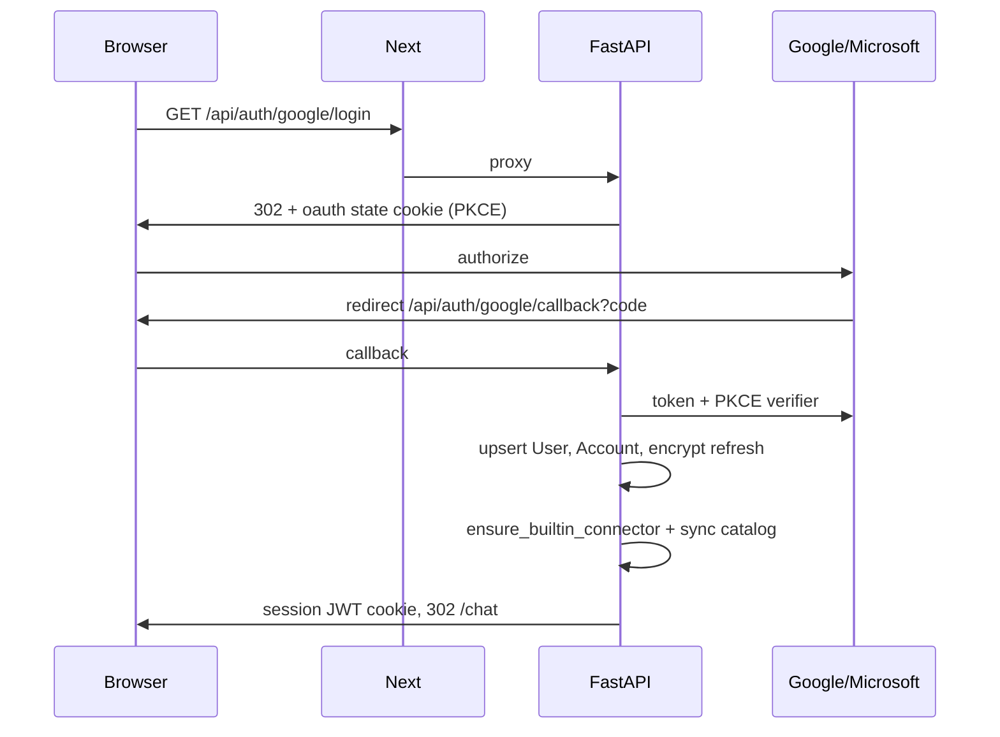
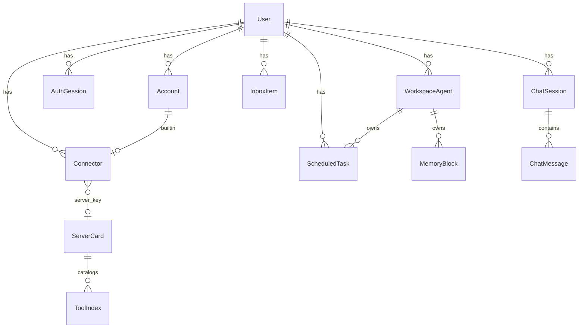
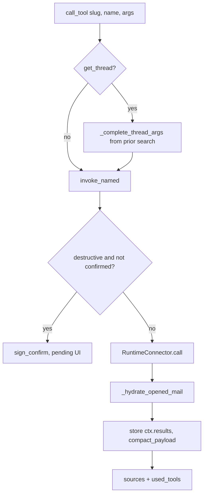
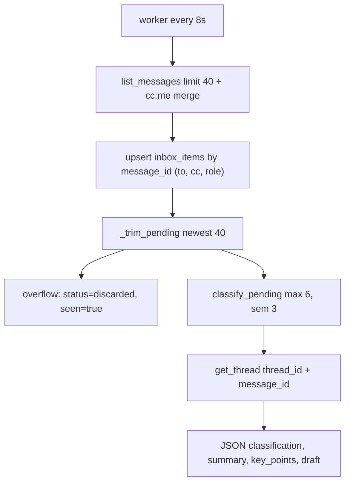

# Low-level design

Module-level design of Checkme: request paths, data model, agent loop, connectors, inbox, and files. Pair with [HLD](HLD.md) and [diagrams](diagrams.md).

## 1. Process and package map

```
apps/web
  app/page.tsx                 Sign-in
  app/chat/page.tsx            Chat + EmailThreadButton
  app/inbox/page.tsx           Triage UI
  app/connectors/page.tsx      Connector management
  app/tasks/page.tsx           Scheduled tasks
  app/components/AppShell.tsx  Nav, bell, SSE
  app/components/EmailThread.tsx
  app/api/[...path]/route.ts   Catch-all proxy to FastAPI
  lib/proxy.ts, lib/backend.ts Runtime API base URL

apps/api/app
  main.py                      FastAPI app, lifespan workers
  auth/                        OAuth + session
  chat/routes.py               Chat + GET /thread
  agent/deep.py                Harness agent (only chat path)
  agent/invoke.py              Named tool dispatch + confirms + files
  agent/attachments.py         Store blobs, extract, summarize
  inbox/                       Ingest, classify, SSE, batch, full thread
  tasks/                       CRUD + scheduler
  connectors/                  Registry, MCP client, runtime
  files.py, storage.py         Upload/download/PDF render
  models.py                    SQLAlchemy

packages/connector_core        ToolSpec, MAIL_CALENDAR_TOOLS, clean_body
packages/gmail_mcp             Gmail REST + Calendar
packages/outlook_mcp           Microsoft Graph
```

Startup (`apps/api/app/main.py` lifespan): `init_db` (create tables + `vector` extension) → `ensure_bucket` → sync builtin connector catalogs → `start_scheduler` + `start_inbox_worker`.

## 2. Web ↔ API

The browser only calls same-origin `/api/*`. Next forwards method, body, and Cookie; it strips hop-by-hop headers.

| Web route | Upstream |
| --- | --- |
| `POST /api/chat` | Dedicated `app/api/chat/route.ts` (120s) |
| `GET /api/inbox/events` | Dedicated SSE proxy, `maxDuration` 300, `X-Accel-Buffering: no` |
| Everything else `/api/*` | `app/api/[...path]/route.ts` → `proxyApi` |

API base: `API_INTERNAL_URL` in Compose (`http://api:8000`), `API_HOSTPORT` on Render. Never bake `localhost:8000` into a production image.

Session cookie is set by FastAPI on OAuth callback (`SESSION_COOKIE`, HttpOnly, Lax, Secure when `PUBLIC_WEB_URL` is https).

## 3. Authentication (LLD)



`current_user` (`deps.py`):

1. Read JWT → `sid`, `sub`.
2. If Redis `revoked:{sid}` → 401.
3. If Redis `sess:{sid}` miss, load `auth_sessions` and cache 300s.
4. Load `users` row.

Linking a second mailbox: `mode=link` + existing session; `link_user` in signed state. Duplicate provider subject on another user → `account_linked_elsewhere`.

Access tokens are not stored long-term. `account_access_token(account_id)` refreshes from the encrypted refresh token (`auth/tokens.py`).

## 4. Data model



| Table | Keys / notes |
| --- | --- |
| `users` | `id`, email, timezone default `Asia/Kolkata`, optional `letta_agent_id` (mirror of Chief’s Letta id) |
| `accounts` | Unique `(provider, subject)`. `refresh_token_enc` |
| `auth_sessions` | `expires_at`, `revoked` |
| `connectors` | Unique `(user_id, slug)`. `kind` builtin\|mcp, `provider` gmail\|outlook\|mcp, `health` |
| `server_cards` | PK `server_key` (`builtin:gmail`, `mcp:<hash>`). `core_tools`, `groups` JSON |
| `tool_index` | Unique `(server_key, tool_name)`. `search_tsv` generated, HNSW on `embedding` |
| `workspace_agents` | Named bot. `kind` `default` (Chief) or `custom`. Optional `letta_agent_id` — one Letta agent per workspace agent |
| `chat_sessions` | `state` JSON. `agent_id` / `group_id` file the thread under one agent or one group |
| `chat_messages` | `meta`: attachments, used_tools, pending_confirms, mail_threads, source |
| `inbox_items` | Unique `(user_id, message_id)`. `to_header`, `cc_header`, `recipient_role` (`to`\|`cc`\|`bcc`). `classification` reply\|respond\|discard, `status` pending\|sent\|discarded |
| `scheduled_tasks` | Index `(status, next_run_at)`. `agent_id` is the workspace agent that owns and runs the routine |
| `thread_summaries` | Cache for `summarize_thread` until `last_message_id` changes |
| `memory_blocks` | PK `(user_id, agent_id, label)`. Fallback core memory for that agent |
| `memory_passages` | Fallback episodic/archival rows, filtered by `agent_id` |
| `automations` | Staff routines. `agent_id` is the agent that created the automation |
| `commitments` / `admin_items` | Staff extractions. Still per user (not per agent) |
| `tool_usage` / `tool_edges` | Routing feedback |

`init_db` uses `create_all` plus `ALTER TABLE … ADD COLUMN IF NOT EXISTS` patches (inbox headers, chat `agent_id` / `group_id`, and per-agent memory/routine columns). No separate migration tool.

Startup backfill (`app/agents/scope.py`, applied from `db.py`): promote an existing agent named Chief to `kind=default` when the user has no default; insert Chief for users who still have unscoped memory, tasks, automations, or a legacy `users.letta_agent_id`; set `agent_id` on those rows to that user’s Chief and copy `users.letta_agent_id` onto Chief. Rows that already have an `agent_id` are left alone. Memory rows that still cannot be assigned are dropped. `memory_blocks` primary key becomes `(user_id, agent_id, label)`.

## 5. HTTP API (FastAPI, prefix `/api`)

### Auth / me

- `GET /auth/status` — which IdPs are configured
- `GET /auth/{google|microsoft}/login?mode=signin|link`
- `GET /auth/{provider}/callback`
- `GET /me`, `PATCH /me` (timezone)

### Chat

- `GET /chat/sessions`, `GET /chat/sessions/{id}`, `DELETE /chat/sessions/{id}`
- `POST /chat` — `{ message, session_id, confirmations, attachments, agent_id?, group_id?, progress_id? }`
- `GET /chat/progress/{progress_id}` — live status lines for an in-flight turn: `{ steps: [{ text, kind, tool, at }], done }` (see 6.5)
- `GET /chat/thread?slug&thread_id&message_id` — full bodies
- `POST /chat/attachments/summarize`

### Inbox

- `GET /inbox?live=1` — optional ingest, no mark_seen
- `GET /inbox/badge`, `POST /inbox/seen`
- `GET /inbox/events` — SSE every 2s; live ingest every 5 ticks
- `PATCH /inbox/{id}` draft, `POST .../rephrase|send|delete` (`send` body: `draft`, `attachment_keys`, `cc`, `bcc`, `reply_all`)
- `GET /inbox/{id}/thread`
- `POST /inbox/batch` — `empty_spam` / `empty_drafts` / `empty_trash` / clear discard / delete ids (`confirm`)

### Connectors / tasks / files

- `GET/POST /connectors`, `PATCH/DELETE /connectors/{id}`, `POST .../sync`, MCP OAuth start/callback
- `GET /connectors/marketplace`, `POST /connectors/marketplace/connect` — Composio app catalog + OAuth link
- Builtin platform connectors (when keys are set): `@computer` (Daytona sandbox) and `@composio` (marketplace `find_tools` / `execute`)
- `GET/POST /tasks`, `PATCH/DELETE /tasks/{id}`, `POST .../run`. `GET` accepts `agent_id` and `status`. `POST` body is `{ prompt, agent_id? }` — omitted `agent_id` uses Chief
- `POST /files/upload`, `GET /files?t=&render=`

Health: FastAPI `GET /health`, web `GET /up`.

## 6. Deep agent

File: `apps/api/app/agent/deep.py`. This is the **only** chat execution path.

### 6.1 Harness tools (what the model sees)

| Tool | Behavior |
| --- | --- |
| `list_connectors` | Enabled connectors for **this user**; mail connectors advertise mail+calendar core tools (never truncated) |
| `search_tools` | Capability query over `tool_index` (embed “Find a connector tool for: …”, OR prefix lexical). If the connector is a gateway, `search_tools` also runs `gateway__tool_search` and returns nested data tools. Catalog tools are scored down. Mail still injects `get_thread` / `empty_folder` / Meet/Teams. |
| `get_tool_schema` | JSON schema from the index, or `gateway__resolve` / a generic object schema for nested tools |
| `call_tool` | `invoke_named` / MCP / builtin. Nested names run through `gateway__execute`. |
| `inspect_result` | Slice stored `ctx.results` by path/search/offset |
| `schedule_task` | Staff persist on the speaking agent’s routines |
| `staff` | Briefing, inbox Q&A, commitments, voice |
| `list_agents_and_groups` | This user's Checkme agents and groups (ids, titles, members, 2–10 limit). Built in, not a connector |
| `create_agent` / `update_agent` | Create, rename, retitle, re-instruct, archive/restore a workspace agent via `agents/service.py` |
| `create_agent_group` | New group from member names/ids, or `all_agents=true` (all non-archived agents). Clear error under 2 or over 10 |
| `add_group_members` / `remove_group_members` / `rename_agent_group` | Edit an existing group; size rule re-checked |
| `delete_agent` / `delete_agent_group` | Never delete directly: return a confirmation card (see 6.4). Refused for Chief and for unattended (`auto_confirm`) runs |

System prompt rules that matter in production:

- Discover, then `call_tool`. Search with a capability phrase, not the user sentence. `search_tools` expands gateway catalogs; nested data tools are the answer, not `gateway__tool_search`. A dated snapshot is still an answer.
- Gmail/Outlook **are** calendar. Meet = `create_google_meet`, Teams = `create_teams_meeting`.
- After search, open/summarize mail with **`get_thread` + message_id**, never an empty `thread_id`. Cover CC’d mail (`recipient_role`). When sending, pass `cc` / `bcc` if the user named other people.
- Large results → `inspect_result`, do not stop at “truncated”.
- Future work → `schedule_task`. Clock-time meetings → `create_event` now.
- Connector answers are a **detailed analyst briefing**, not a short brief.
- Destructive tools still `call_tool`; the app confirms.
- Checkme's own agents/groups use the workspace tools above, never `search_tools`/`call_tool` or a third-party "group" (LiveChat, Slack…). After a change the reply says it is in the left sidebar under **Personal**. There is no group lead setting (the first member answers).

Recursion: `max_agent_steps * 8` (floor 80), retry twice up to 200 if LangGraph hits the limit.

### 6.2 `call_tool` internals



`invoke_named` (`agent/invoke.py`):

- `send_message` / `reply` / `forward` / `create_draft` load `attachment_keys` from storage into `files`. Confirm preview includes `to`, `cc`, `bcc`, `reply_all`.
- Virtual tools: `summarize_thread`, `summarize_attachments`, `read_attachment_text`.
- `get_message` / `get_thread`: hydrate attachment cards (preview URLs), do not dump bytes into the model.
- `empty_folder` / `bulk_delete`: first call may be preview `dry_run` for the confirm card; execution sets `dry_run=False`.

Payload size: default compact at 24k chars; `get_thread` / `get_message` at 60k. Over limit → `{ too_large, map, result_id }`.

### 6.3 Mail hydration

Triggers: user text contains open / summarize / thread / conversation / email / mail / inbox / briefing / read / pdf / attachment / …

On `search_messages`, `list_messages`, `list_threads`, `get_message`:

1. Take first hit’s `thread_id` + `message_id`.
2. `get_thread({ thread_id, message_id, max_messages: 50 })`.
3. If last message has files, `summarize_attachments`.
4. Attach `opened_thread`, set `thread_id` / `message_id` on the payload, record `slug__get_thread` in `used_tools`.

If the model later calls `get_thread` with an empty id, `_complete_thread_args` copies ids from the previous result.

Chat response meta includes `mail_threads: [{ connector_slug, thread_id, message_id, subject }]`.

### 6.4 Workspace (agents and groups) tools

File: `apps/api/app/agents/chat_tools.py`, wired in `harness_tools`. Agents and groups are referenced by id or name (case-insensitive, unique partial match), so the model can pass what the user said. Every mutation goes through `app/agents/service.py`, so the sidebar's rules apply (unique names, 20-agent cap, 2–10 members, Chief protected).

Deletes reuse the connector confirmation flow: `request_delete` signs `sign_confirm("tool", {slug: "__checkme_workspace__", tool: "delete_agent"|"delete_group", args: {id, name}})` and appends to `ctx.pending`. When the user presses Confirm, chat posts the token back; `run_deep_agent` sees the workspace slug in `confirmations` and runs `chat_tools.run_confirmed` (not `call_user_tool`). A teammate's pending cards are passed up to the lead's response.

Any successful mutation sets `ctx.workspace_changed`; `run_deep_agent` returns `workspace_changed: true`, the chat page fires `checkme:workspace-changed` on `window`, and `AgentsNav` refetches `GET /api/agents` so new agents/groups appear without a reload.

### 6.5 Live status narration

File: `apps/api/app/agent/progress.py`. The chat bubble no longer cycles canned phrases ("Thinking", "Checking connected sources", "Writing a reply"). Status text is derived from the agent's real events, with no extra LLM calls:

- The web app makes a `progress_id` per send (`turn_…`, `[A-Za-z0-9_-]{8,64}`) and posts it with `POST /chat`.
- The route builds a `ProgressReporter(user.id, progress_id)` and passes it to `run_deep_agent(progress=…)`, which puts it on `RunContext.progress` and adds a `ProgressCallback` to the graph's `ainvoke` config `callbacks`. LangGraph forwards callbacks to every model and tool call (harness tools and deepagents built-ins such as `write_todos`, `read_file`, `task`).
- `on_tool_start` → `describe_tool(name, args, connector_names)`: e.g. `call_tool(gmail, GMAIL_SEARCH_MESSAGES, {query})` → "Gmail: search messages for “invoice”", gateway `tool_search` → "Finding the right GitHub tool for “…”", `browser_navigate` → "Opening example.com in the browser", `create_agent_group` → "Creating the group “Crew” with all your agents", `ask_teammate` → "Asking Dev: …", `write_todos` → "Next: <in-progress todo>". Unknown tools fall back to the humanized tool name plus its key argument.
- Model events: first model call → "Working out how to handle “<request>”"; a model call after tools → "Going over what <connector> returned"; an AI message with tool calls and text → its first sentence (the model's own narration); a final AI message → "Writing the reply". Tool errors → "<tool> hit an error, trying another way". Confirmed actions → "Running what you confirmed: …".
- Teammate runs get `progress.child(name)`, which prefixes lines ("Dev: GitHub: create pull request") and passes them explicit callbacks, so the parent's handler does not double-report.
- Lines are de-duplicated, clipped to 140 chars, and `RPUSH`ed to Redis `chatprog:{user_id}:{progress_id}` (TTL 900s, max 60). Redis failures are swallowed; the turn still completes. The route's `finally` appends a `done` step. The step texts are also saved on the assistant message as `meta.steps`.
- `GET /chat/progress/{id}` reads only the caller's own key. The chat page polls it every 1.2s while that scope is busy (`pollProgress` in `app/chat/page.tsx`) and `Thinking.tsx` shows the latest line with the previous three as a ✓ trail. Before the first line arrives it shows "Starting on “<your message>”".

### 6.6 Agent focus (new-agent onboarding)

Files: `apps/api/app/agents/focus.py`, `apps/api/app/agent/coding.py`, `apps/web/app/components/FocusCard.tsx`.

- `workspace_agents.focus` (`VARCHAR(40)`, ad-hoc `ALTER` in `db.py`) is one of `email_calendar | coding | research | errands`, or `""` when it isn't set. `POST /agents` and `PATCH /agents/{id}` accept `focus`. Labels and aliases are normalized ("Coding and deployments", "dev" → `coding`), and unknown values return 400. Setting a focus on an agent with no title also gives it a default title (e.g. `software engineer`). `serialize_agent` returns `focus` and `focus_label`.
- **Card:** a custom agent with no focus, on an empty chat, shows a greeting bubble ("Hi <first name>, I'm <agent>. Happy to be here, and I'd love to get a sense of how I can make your days easier."). Below it is the dismissible card "What would you most like a hand with?" with A Email and calendar, B Coding and deployments, C Research and writing, D Errands and bookings, and the hint "Or answer in the chat below". The existing hero cards stay underneath. Picking an option calls `PATCH /agents/{id} {focus}` and then sends the option's answer as the user's message. Dismissing the card is saved in localStorage per agent. Chief (`kind=default`) and groups never show it.
- **Free answer:** a custom agent with no focus and no instructions gets `UNSET_PROMPT` and the `set_my_focus(focus)` harness tool, so a typed answer also sets the focus (`workspace_changed` refreshes the sidebar).
- **Prompt:** `system_prompt` appends `focus_prompt(agent)` after the agent's instructions. Email/calendar and errands get light defaults. Research gets: browser or web_fetch, at least three sources, inline [n] citations plus a Sources list, then outline and draft.
- **Coding (`focus=coding`), plan then build:** the prompt requires `write_todos` first, then `coding_workspace_status`, then work on the computer. That means `git clone` into `~/work/<repo>`, editing, installing, and running tests and builds until they pass, on a new branch with commits. Pushing and opening a PR uses sandbox `gh`/git credentials or the connected GitHub tools, and never merges unless asked. Deploys are triggered or checked through a deploy connector (Render MCP, Vercel, …). If something is missing, the agent says exactly what. Extra harness tools exist only for coding agents:
  - `coding_workspace_status`: one sandbox `exec` probe (git, gh, `gh auth`, credential helper, node, python, `~/work`) plus a connector scan (GitHub by slug/provider/name/tags, deploy hints, Composio). It returns `can`, `missing`, `workdir`, `github_connectors` and `deploy_connectors`.
  - `sandbox_shell(command, cwd?, timeout=300)`: `call_user_tool(computer, exec)` with a 10–900s timeout. Without a computer it returns the "Daytona is not configured" message.
  - Coding agents get `recursion_limit ≥ 200` (retries up to 280; teammate runs up to 120).
  - Permissions are unchanged: sandbox `exec` isn't destructive, so it runs without a card, and destructive connector tools still use the confirmation card.

## 7. Connector runtime

`RuntimeConnector.call(name, args)`:

- **builtin** `gmail` / `outlook`: instantiate package connector with `account_access_token`, `BaseConnector.call` → `tool_{name}(**accepted args)`. Extra keys (e.g. `full`, `message_id`) are passed if the method signature has them.
- **mcp**: decrypt creds, refresh OAuth if needed, `call_mcp_tool(server_url, creds, name, args)`.

Gmail and Outlook share `MAIL_CALENDAR_TOOLS` in `connector_core/mail_tools.py` (identical names). API-side extras in `connectors/virtual.py`: `summarize_thread`, `summarize_attachments`, `read_attachment_text`.

- **builtin** `github_app` (`connectors/github_app.py`, slug `github-app`): Checkme GitHub App. Each call mints an installation token through `POST /app/installations/{id}/access_tokens` with `repositories=[name]` and the minimum `permissions`, cached in memory until 5 min before expiry. The installation comes from `github_installations` by repo owner. Reads: `list_repos`, `get_file`, `list_prs`, `get_pull_request`, `list_issues`. Writes: `comment_pull_request`, plus the destructive `create_pull_request`, `push_files` (`agent/*` only, via the Git Data API) and `merge_pull_request`. Routes `/api/connectors/github/{status,install,callback,webhook}`. The callback only trusts `installation_id` once the OAuth `code` proves `GET /user/installations` contains it. The connector row is created by `ensure_platform_connectors` once the user has an installation. Setup: `docs/GITHUB_APP.md`.
- **Git-write gate** (`deep.git_write_gate` → `github_app.is_git_write`): GitHub App write tools, and any GitHub/GitLab connector tool named like merge/push/create PR/commit/update file, need a confirm card even when `auto_confirm` is true.

### 7.1 Outlook `get_thread`

Problem: Graph `$search` often omits `conversationId`, so the agent used to call `get_thread` with an empty id and return **one** message (the latest reply). Quoted history was also stripped (`clean_body` default).

Resolution (`packages/outlook_mcp/.../connector.py`):

1. `_ensure_conversation_ids` on list/search: GET missing `conversationId`.
2. `_summary.thread_id` = conversationId or message id (never null).
3. `_resolve_conversation(thread_id, message_id)`:
   - GET message if `message_id` or Graph message-shaped id (`AAMk…`)
   - Subject-like strings → search, then GET
   - Else use `thread_id` as `conversationId` (`AAQk…`)
4. `_messages_by_conversation`:
   - `$filter=conversationId eq '…'` + `ConsistencyLevel: eventual` + `$count`, **paginate**
   - If ≤1 row: KQL `conversationid:`, then per-folder filter (inbox, sentitems, deleted, archive, junk, drafts)
   - If still ≤1: `$search` subject core, match conversation or normalized subject
   - Merge seed message
5. `full=true` or single message → `keep_quoted=True`, body limit 20k; else 2500.

Gmail: `GET /threads/{id}` after resolving `threadId` from `messages/{id}` or from a subject search. Same `full` / quoted rules.

`reply` extra recipients: Gmail composes To from Reply-To/From, merges Reply-all To/Cc plus extra `cc`, and sets `Bcc`. Outlook uses `reply` / `replyAll` when there are no extras or files; otherwise `createReply` / `createReplyAll`, PATCH merged `ccRecipients` / `bccRecipients`, attach, then send. `send_message` already takes `cc` and `bcc` on both providers.

`GET /api/inbox/{id}/thread` and `GET /api/chat/thread` always pass `full=True`, `max_messages=100`.

## 8. Inbox pipeline



Constants (`inbox/service.py`): `KEEP_PENDING=40`, `MAX_CLASSIFY=6`, classes `reply | respond | discard`.

`list_messages` (Gmail INBOX / Outlook inbox, no `page_token`) merges a second query (`cc:me` / Graph `cc:{mailbox}`) via `merge_message_lists` so CC hits are not truncated off the folder page. `_summary` sets `recipient_role` with `connector_core.mail_tools.recipient_role(my_email, to, cc)`: listed on To → `to`; listed on Cc only → `cc`; in inbox but listed on neither → `bcc`.

`_classify_one` always prefers `get_thread`. If that fails, `get_message` then retry thread with the returned `thread_id`. Prompt includes to/cc/`recipient_role` and up to 40 messages (bodies clipped, JSON clipped to 30k). Do not discard only because the user is not primary To.

Serialize and `_alert` include `to`, `cc`, `recipient_role`, and `connector_slug` (so the UI can fetch the full thread). `send_reply` parses address lists and calls connector `reply` with `cc`, `bcc`, `reply_all`.

Staff `today_briefing` lists unread (limit 20) with role fields and a **CC’d to you** section. `ask_inbox` cites `recipient_role`.

Batch mailbox actions call connector `empty_folder` per mail runtime (`spam|drafts|trash`).

SSE payload: `{ count, pending, items, inbox, connected }`. Web `readBadge` must keep `inbox` (otherwise the bell updates and the list does not).

## 9. Files and previews

`storage.py`: S3/MinIO or disk (`FILE_STORAGE=disk`, Render). Keys `{user_id}/{uuid}/{filename}`.

Upload returns `{ key, filename, download_url, preview_url, previewable, extracted_text? }`. Chat user bubble and inbox chips show these. Send paths pass keys; `invoke_named` reads bytes only at send time.

`GET /files?t=` validates a signed token (1h). `render=1` on PDF → PNG via pypdfium2, max 12 pages. `AttachmentWidget` uses that PNG and CSS pan/zoom so Safari does not iframe-fail.

## 10. Scheduler

`tasks/scheduler.py`: every 20s, up to 6 due `active` rows → `running` → `execute_task` (deep agent, `auto_confirm=True`, **as the task’s workspace agent**) → store `last_result` / `last_error`, bump `run_count`, set next run or `done`. The run’s chat session is filed under that agent (`ChatSession.agent_id`), and the agent’s persona, memory, and connector limits apply. `auto_confirm` is unchanged.

Chat `schedule_task` parses natural time in `tasks/parse.py` (IST) and stores the speaking agent on the row. Creating a calendar event at a clock time is **not** a scheduled task; that is `create_event` immediately. The Tasks page can filter by agent and the create sheet picks an agent (default: the last agent you chatted with, otherwise Chief).

## 11. Memory

Memory is per workspace agent, not per user. Chief is the default agent (`ensure_default_agent`).

If `LETTA_BASE_URL` is set, each workspace agent has its own Letta agent (`workspace_agents.letta_agent_id`). Chief reuses the legacy `users.letta_agent_id` when that was the only id. A custom agent never reads or writes Chief’s Letta agent. `load_memory` reads that Letta agent and merges this agent’s fallback rows so backfilled notes still show. `remember` / `upsert_core` write both the Letta agent and the fallback tables.

When Letta is unset or unreachable:

- `memory_blocks` label `voice` and any other core labels, keyed by `agent_id`
- `memory_passages` kind `episodic` / `archival` with embeddings, filtered by `agent_id`
- Each chat turn `remember`s a clipped Q/A onto the speaking agent

**Group chats.** The lead and each teammate call `run_deep_agent` with their own `WorkspaceAgent`. Each speaker loads and writes only that agent’s memory. The lead’s episodic note is the user question plus the lead’s combined answer. A teammate’s note is the delegated prompt plus their reply. A routine created while speaking belongs to the speaker, not the group.

**Inbox voice.** Triage drafts read Chief’s `voice` block only. `learn_voice` in another agent’s chat updates that agent’s block and does not change Chief.

**Deleting an agent.** Custom agents can be deleted; Chief cannot. Delete removes that agent’s memory blocks, passages, scheduled tasks, and automations (foreign keys cascade the same rows). The remote Letta agent is deleted when its id is not Chief’s shared user id; a Letta outage does not block the local delete. Chat sessions are left in place with the old `agent_id` so transcripts are not copied onto Chief.

Staff `learn_voice` updates the speaking agent’s voice block from sent mail.

## 12. Frontend behavior that matches the API

| UI | Implementation |
| --- | --- |
| Bell | `subscribeInbox` EventSource `/api/inbox/events`; `onerror` → `inboxBadge()` 3s; click `markInboxSeen` |
| Inbox refresh | `GET /api/inbox?live=1`; listen `inbox-live` only if `detail.inbox` is an array |
| Inbox send copy | Cc / Bcc inputs + Reply all; `POST /send` with parsed address lists |
| Bell CC label | `recipient_role` `cc`/`bcc` → Cc / Bcc tag on the notify row |
| See full email | `EmailThread.tsx` — inbox uses `item_id`; chat uses `mailRefsFromMeta(meta)` |
| Confirm | `pending_confirms[]` with `token`; POST chat `{ confirmations: [{ token }] }` |
| Attach | `uploadFiles` then state update (**await outside setState** — Next build requirement) |
| Chat meta | Assistant bubble stores whole POST body (`used_tools`, `attachments`, `mail_threads`) |
| Tasks | Filter by agent; create sheet sends `agent_id` (last chat agent, else Chief) |
| Live status | `send()` makes a `progress_id`, polls `GET /api/chat/progress/{id}` (through `[...path]`) until the POST returns; `Thinking` renders the latest step + trail |
| Agent focus card | Empty chat of a custom agent with no `focus` → `FocusOnboarding` (A–D). Pick → `updateAgent(id, {focus})` then `send(answer)`; × saves `checkme.focusCard.dismissed.<id>` |
| Sidebar refresh | Chat response `workspace_changed` → `announceWorkspaceChanged()` → `AgentsNav` listens for `checkme:workspace-changed` and calls `loadWorkspace()` |

## 13. Error handling

| Failure | Behavior |
| --- | --- |
| OAuth refresh 4xx | `ReauthRequired` → connector `auth_expired` |
| Tool exception | `{ error }` to the model; usage failure bump |
| Inbox ingest/classify | logged, other users continue |
| Chat agent exception | HTTP 502, message stored only on success path |
| SSE drop | client badge poll |
| File token expired | 404, “ask again in chat” |
| Recursion limit | retry with higher limit, then user-visible failure string |

## 14. Tests (representative)

| File | What it locks |
| --- | --- |
| `test_mail_thread.py` | Outlook resolves `message_id`, lists 2+ messages, keeps quotes when Graph returns 1, fills missing conversationId on search |
| `test_deep_harness.py` | Catalog dumps not truncated, hydration calls `get_thread`, empty thread_id filled from prior search, prompt has get_thread / analyst rules |
| `test_inbox_triage.py` | Classification aliases, serialize slug/role, newest-40 split, `recipient_role`, `merge_message_lists`, `_address_list` |
| `test_attachments.py` | Previewable types |
| `test_routing*.py` | Tool search / describe |
| `test_agent_scope.py` | Memory isolation, task `agent_id`, `execute_task` agent, Chief backfill |
| `test_agent_chat_tools.py` | Workspace tools registered and in prompt; create/rename agent; group from all/named agents, 2–10 errors, add/remove/rename; deletes only via confirmation, Chief and unattended refused; confirmed delete runs in `run_deep_agent` |

| `test_progress.py` | Status lines from real tool/model events (connector, query, URL, group, teammate, todos), Redis buffer + TTL + dedupe, Redis outage tolerated, teammate prefix, nested callbacks not double-reported, `run_deep_agent` wires the callback, `GET /chat/progress/{id}` |

| `test_agent_focus.py` | A–D order, focus normalize/reject, `update_agent` focus + default title, route models, coding/research/unset prompts, coding-only tools, `set_my_focus`, `sandbox_shell` → computer `exec` (timeout clamp, missing computer), `coding_workspace_status` ready/missing, bigger step budget |

Run: `apps/api/.venv/bin/python -m pytest -q`.

## 15. Configuration (API)

See `.env.example`. Important knobs in `app/config.py`:

| Key | Role |
| --- | --- |
| `PUBLIC_WEB_URL` | OAuth redirects + cookie Secure |
| `OPENAI_API_KEY` / `OPENAI_MODEL` | Chat (default `gpt-6-luna`) via `/v1/responses` |
| `OPENAI_REASONING_EFFORT` | Responses `reasoning.effort` (`none`). Tool search uses a capability query (not the raw user sentence); catalog tools like `gateway__tool_search` are not data answers. |
| `GOOGLE_*` / `MICROSOFT_*` | Must be on **checkme-api** in Render |
| `SESSION_SECRET` / `TOKEN_ENCRYPTION_KEY` | Cookies + Fernet |
| `FILE_STORAGE` | `s3` local, `disk` Render |
| `ALLOW_PRIVATE_MCP_URLS` | true only on Compose |
| `chat_rate_limit_per_minute` | 30 |
| `history_messages` | 8 prior turns into the agent |
| `max_agent_steps` | 20 (recursion uses ×8) |
| `GITHUB_APP_ID` / `GITHUB_APP_PRIVATE_KEY` / `GITHUB_APP_SLUG` | Turn on the Checkme GitHub App |
| `GITHUB_APP_CLIENT_ID` / `GITHUB_APP_CLIENT_SECRET` | Verify installers on the callback |
| `GITHUB_APP_WEBHOOK_SECRET` | `X-Hub-Signature-256` on `/api/connectors/github/webhook` |

Do not commit `.env`.
