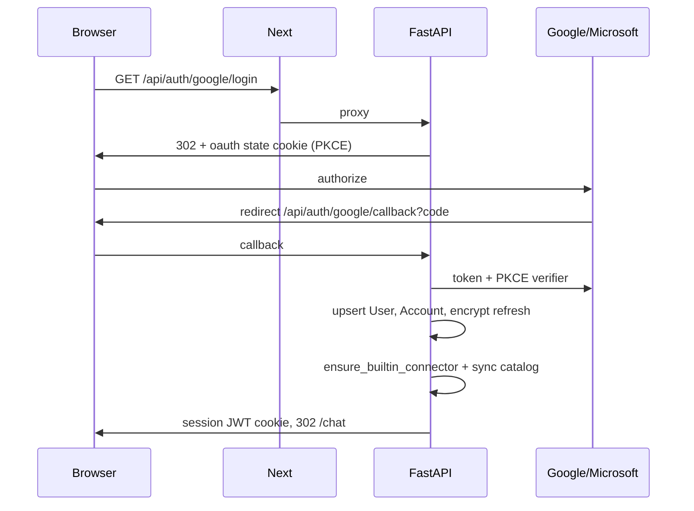
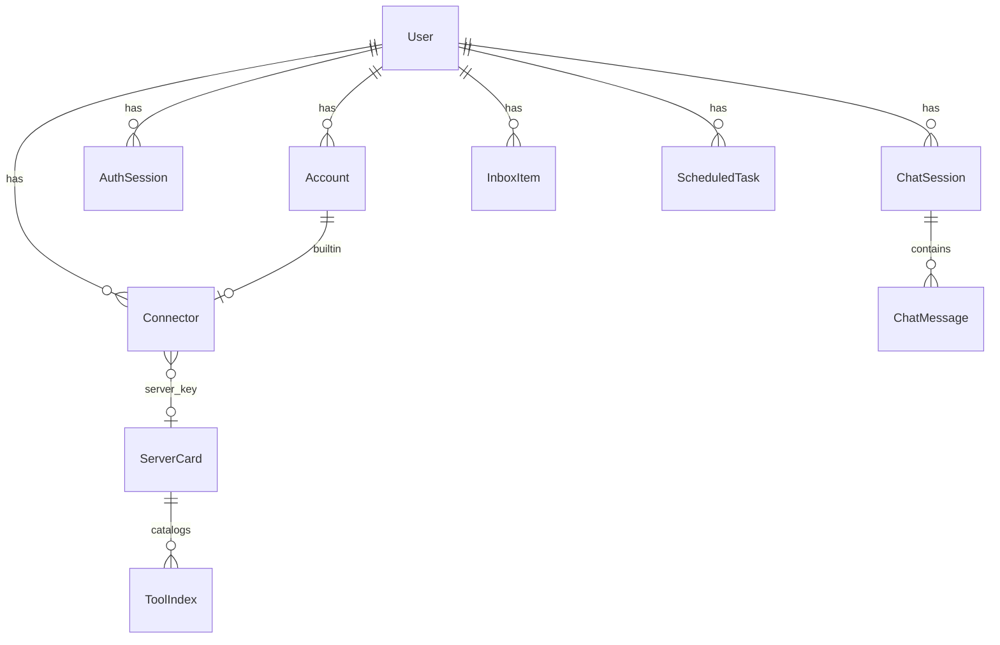
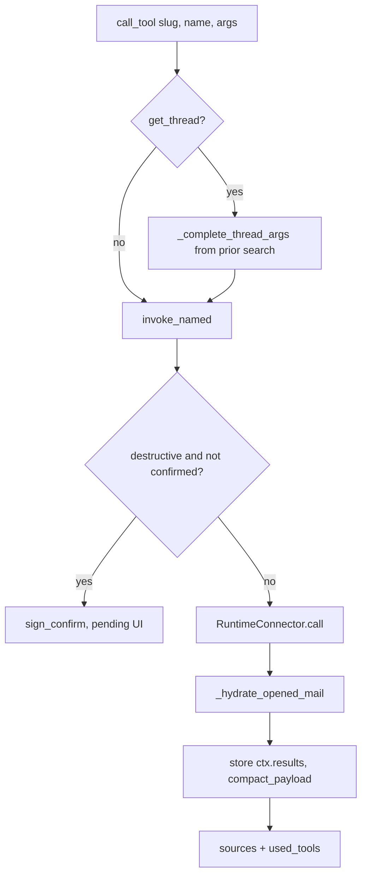
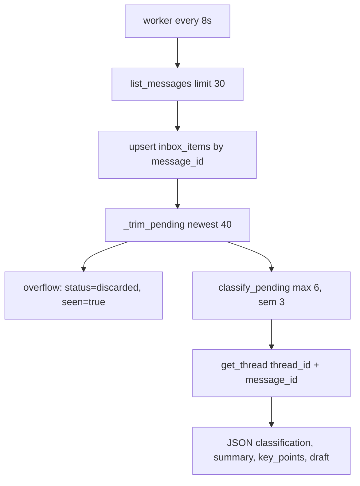

# Low-level design

Module-level design of Checkme: request paths, data model, agent loop, connectors, inbox, and files. Pair with [HLD](HLD.md) and [diagrams](diagrams.md).

## 1. Process and package map

```
apps/web
  app/page.tsx                 Sign-in
  app/chat/page.tsx            Chat + EmailThreadButton
  app/inbox/page.tsx           Triage UI
  app/connectors/page.tsx      Connector management
  app/tasks/page.tsx           Scheduled tasks
  app/components/AppShell.tsx  Nav, bell, SSE
  app/components/EmailThread.tsx
  app/api/[...path]/route.ts   Catch-all proxy to FastAPI
  lib/proxy.ts, lib/backend.ts Runtime API base URL

apps/api/app
  main.py                      FastAPI app, lifespan workers
  auth/                        OAuth + session
  chat/routes.py               Chat + GET /thread
  agent/deep.py                Harness agent (only chat path)
  agent/invoke.py              Named tool dispatch + confirms + files
  agent/attachments.py         Store blobs, extract, summarize
  inbox/                       Ingest, classify, SSE, batch, full thread
  tasks/                       CRUD + scheduler
  connectors/                  Registry, MCP client, runtime
  files.py, storage.py         Upload/download/PDF render
  models.py                    SQLAlchemy

packages/connector_core        ToolSpec, MAIL_CALENDAR_TOOLS, clean_body
packages/gmail_mcp             Gmail REST + Calendar
packages/outlook_mcp           Microsoft Graph
```

Startup (`apps/api/app/main.py` lifespan): `init_db` (create tables + `vector` extension) → `ensure_bucket` → sync builtin connector catalogs → `start_scheduler` + `start_inbox_worker`.

## 2. Web ↔ API

The browser only calls same-origin `/api/*`. Next forwards method, body, and Cookie; it strips hop-by-hop headers.

| Web route | Upstream |
| --- | --- |
| `POST /api/chat` | Dedicated `app/api/chat/route.ts` (120s) |
| `GET /api/inbox/events` | Dedicated SSE proxy, `maxDuration` 300, `X-Accel-Buffering: no` |
| Everything else `/api/*` | `app/api/[...path]/route.ts` → `proxyApi` |

API base: `API_INTERNAL_URL` in Compose (`http://api:8000`), `API_HOSTPORT` on Render. Never bake `localhost:8000` into a production image.

Session cookie is set by FastAPI on OAuth callback (`SESSION_COOKIE`, HttpOnly, Lax, Secure when `PUBLIC_WEB_URL` is https).

## 3. Authentication (LLD)



`current_user` (`deps.py`):

1. Read JWT → `sid`, `sub`.
2. If Redis `revoked:{sid}` → 401.
3. If Redis `sess:{sid}` miss, load `auth_sessions` and cache 300s.
4. Load `users` row.

Linking a second mailbox: `mode=link` + existing session; `link_user` in signed state. Duplicate provider subject on another user → `account_linked_elsewhere`.

Access tokens are not stored long-term. `account_access_token(account_id)` refreshes from the encrypted refresh token (`auth/tokens.py`).

## 4. Data model



| Table | Keys / notes |
| --- | --- |
| `users` | `id`, email, timezone default `Asia/Kolkata`, optional `letta_agent_id` |
| `accounts` | Unique `(provider, subject)`. `refresh_token_enc` |
| `auth_sessions` | `expires_at`, `revoked` |
| `connectors` | Unique `(user_id, slug)`. `kind` builtin\|mcp, `provider` gmail\|outlook\|mcp, `health` |
| `server_cards` | PK `server_key` (`builtin:gmail`, `mcp:<hash>`). `core_tools`, `groups` JSON |
| `tool_index` | Unique `(server_key, tool_name)`. `search_tsv` generated, HNSW on `embedding` |
| `chat_sessions` | `state` JSON (last source, confirm tools) |
| `chat_messages` | `meta`: attachments, used_tools, pending_confirms, mail_threads, source |
| `inbox_items` | Unique `(user_id, message_id)`. `classification` reply\|respond\|discard, `status` pending\|sent\|discarded |
| `scheduled_tasks` | Index `(status, next_run_at)` |
| `thread_summaries` | Cache for `summarize_thread` until `last_message_id` changes |
| `memory_blocks` / `memory_passages` | Voice + episodic when Letta is unset |
| `commitments` / `admin_items` / `automations` | Staff tools |
| `tool_usage` / `tool_edges` | Routing feedback |

`init_db` uses `create_all` plus a few `ALTER TABLE IF NOT EXISTS` patches. No separate migration tool.

## 5. HTTP API (FastAPI, prefix `/api`)

### Auth / me

- `GET /auth/status` — which IdPs are configured
- `GET /auth/{google|microsoft}/login?mode=signin|link`
- `GET /auth/{provider}/callback`
- `GET /me`, `PATCH /me` (timezone)

### Chat

- `GET /chat/sessions`, `GET /chat/sessions/{id}`, `DELETE /chat/sessions/{id}`
- `POST /chat` — `{ message, session_id, confirmations, attachments }`
- `GET /chat/thread?slug&thread_id&message_id` — full bodies
- `POST /chat/attachments/summarize`

### Inbox

- `GET /inbox?live=1` — optional ingest, no mark_seen
- `GET /inbox/badge`, `POST /inbox/seen`
- `GET /inbox/events` — SSE every 2s; live ingest every 5 ticks
- `PATCH /inbox/{id}` draft, `POST .../rephrase|send|delete`
- `GET /inbox/{id}/thread`
- `POST /inbox/batch` — `empty_spam` / `empty_drafts` / `empty_trash` / clear discard / delete ids (`confirm`)

### Connectors / tasks / files

- `GET/POST /connectors`, `PATCH/DELETE /connectors/{id}`, `POST .../sync`, MCP OAuth start/callback
- `GET/POST /tasks`, `PATCH/DELETE /tasks/{id}`, `POST .../run`
- `POST /files/upload`, `GET /files?t=&render=`

Health: FastAPI `GET /health`, web `GET /up`.

## 6. Deep agent

File: `apps/api/app/agent/deep.py`. This is the **only** chat execution path.

### 6.1 Harness tools (what the model sees)

| Tool | Behavior |
| --- | --- |
| `list_connectors` | Enabled connectors for **this user**; mail connectors advertise mail+calendar core tools (never truncated) |
| `search_tools` | `search_tools()` over `tool_index` + keyword injection (`get_thread`, `empty_folder`, Meet/Teams, …) |
| `get_tool_schema` | JSON schema from the index |
| `call_tool` | `invoke_named` / MCP / builtin |
| `inspect_result` | Slice stored `ctx.results` by path/search/offset |
| `schedule_task` | Staff persist |
| `staff` | Briefing, inbox Q&A, commitments, voice |

System prompt rules that matter in production:

- Discover, then `call_tool`. Catalog search is not an answer.
- Gmail/Outlook **are** calendar. Meet = `create_google_meet`, Teams = `create_teams_meeting`.
- After search, open/summarize mail with **`get_thread` + message_id**, never an empty `thread_id`.
- Large results → `inspect_result`, do not stop at “truncated”.
- Future work → `schedule_task`. Clock-time meetings → `create_event` now.
- Connector answers are a **detailed analyst briefing**, not a short brief.
- Destructive tools still `call_tool`; the app confirms.

Recursion: `max_agent_steps * 8` (floor 80), retry twice up to 200 if LangGraph hits the limit.

### 6.2 `call_tool` internals



`invoke_named` (`agent/invoke.py`):

- `send_message` / `reply` / `forward` / `create_draft` load `attachment_keys` from storage into `files`.
- Virtual tools: `summarize_thread`, `summarize_attachments`, `read_attachment_text`.
- `get_message` / `get_thread`: hydrate attachment cards (preview URLs), do not dump bytes into the model.
- `empty_folder` / `bulk_delete`: first call may be preview `dry_run` for the confirm card; execution sets `dry_run=False`.

Payload size: default compact at 24k chars; `get_thread` / `get_message` at 60k. Over limit → `{ too_large, map, result_id }`.

### 6.3 Mail hydration

Triggers: user text contains open / summarize / thread / conversation / email / mail / inbox / briefing / read / pdf / attachment / …

On `search_messages`, `list_messages`, `list_threads`, `get_message`:

1. Take first hit’s `thread_id` + `message_id`.
2. `get_thread({ thread_id, message_id, max_messages: 50 })`.
3. If last message has files, `summarize_attachments`.
4. Attach `opened_thread`, set `thread_id` / `message_id` on the payload, record `slug__get_thread` in `used_tools`.

If the model later calls `get_thread` with an empty id, `_complete_thread_args` copies ids from the previous result.

Chat response meta includes `mail_threads: [{ connector_slug, thread_id, message_id, subject }]`.

## 7. Connector runtime

`RuntimeConnector.call(name, args)`:

- **builtin** `gmail` / `outlook`: instantiate package connector with `account_access_token`, `BaseConnector.call` → `tool_{name}(**accepted args)`. Extra keys (e.g. `full`, `message_id`) are passed if the method signature has them.
- **mcp**: decrypt creds, refresh OAuth if needed, `call_mcp_tool(server_url, creds, name, args)`.

Gmail and Outlook share `MAIL_CALENDAR_TOOLS` in `connector_core/mail_tools.py` (identical names). API-side extras in `connectors/virtual.py`: `summarize_thread`, `summarize_attachments`, `read_attachment_text`.

### 7.1 Outlook `get_thread`

Problem: Graph `$search` often omits `conversationId`, so the agent used to call `get_thread` with an empty id and return **one** message (the latest reply). Quoted history was also stripped (`clean_body` default).

Resolution (`packages/outlook_mcp/.../connector.py`):

1. `_ensure_conversation_ids` on list/search: GET missing `conversationId`.
2. `_summary.thread_id` = conversationId or message id (never null).
3. `_resolve_conversation(thread_id, message_id)`:
   - GET message if `message_id` or Graph message-shaped id (`AAMk…`)
   - Subject-like strings → search, then GET
   - Else use `thread_id` as `conversationId` (`AAQk…`)
4. `_messages_by_conversation`:
   - `$filter=conversationId eq '…'` + `ConsistencyLevel: eventual` + `$count`, **paginate**
   - If ≤1 row: KQL `conversationid:`, then per-folder filter (inbox, sentitems, deleted, archive, junk, drafts)
   - If still ≤1: `$search` subject core, match conversation or normalized subject
   - Merge seed message
5. `full=true` or single message → `keep_quoted=True`, body limit 20k; else 2500.

Gmail: `GET /threads/{id}` after resolving `threadId` from `messages/{id}` or from a subject search. Same `full` / quoted rules.

`GET /api/inbox/{id}/thread` and `GET /api/chat/thread` always pass `full=True`, `max_messages=100`.

## 8. Inbox pipeline



Constants (`inbox/service.py`): `KEEP_PENDING=40`, `MAX_CLASSIFY=6`, classes `reply | respond | discard`.

`_classify_one` always prefers `get_thread`. If that fails, `get_message` then retry thread with the returned `thread_id`. Prompt includes up to 40 messages (bodies clipped, JSON clipped to 30k).

Serialize includes `connector_slug` so the UI can fetch the full thread.

Batch mailbox actions call connector `empty_folder` per mail runtime (`spam|drafts|trash`).

SSE payload: `{ count, pending, items, inbox, connected }`. Web `readBadge` must keep `inbox` (otherwise the bell updates and the list does not).

## 9. Files and previews

`storage.py`: S3/MinIO or disk (`FILE_STORAGE=disk`, Render). Keys `{user_id}/{uuid}/{filename}`.

Upload returns `{ key, filename, download_url, preview_url, previewable, extracted_text? }`. Chat user bubble and inbox chips show these. Send paths pass keys; `invoke_named` reads bytes only at send time.

`GET /files?t=` validates a signed token (1h). `render=1` on PDF → PNG via pypdfium2, max 12 pages. `AttachmentWidget` uses that PNG and CSS pan/zoom so Safari does not iframe-fail.

## 10. Scheduler

`tasks/scheduler.py`: every 20s, up to 6 due `active` rows → `running` → `execute_task` (deep agent, `auto_confirm=True`) → store `last_result` / `last_error`, bump `run_count`, set next run or `done`.

Chat `schedule_task` parses natural time in `tasks/parse.py` (IST). Creating a calendar event at a clock time is **not** a scheduled task; that is `create_event` immediately.

## 11. Memory

If `LETTA_BASE_URL` is set, `ensure_letta_agent` + Letta passages. Otherwise:

- `memory_blocks` label `voice` (inbox draft tone)
- `memory_passages` kind `episodic` / `archival` with embeddings
- Each chat turn `remember`s a clipped Q/A

Staff `learn_voice` updates the voice block from sent mail.

## 12. Frontend behavior that matches the API

| UI | Implementation |
| --- | --- |
| Bell | `subscribeInbox` EventSource `/api/inbox/events`; `onerror` → `inboxBadge()` 3s; click `markInboxSeen` |
| Inbox refresh | `GET /api/inbox?live=1`; listen `inbox-live` only if `detail.inbox` is an array |
| See full email | `EmailThread.tsx` — inbox uses `item_id`; chat uses `mailRefsFromMeta(meta)` |
| Confirm | `pending_confirms[]` with `token`; POST chat `{ confirmations: [{ token }] }` |
| Attach | `uploadFiles` then state update (**await outside setState** — Next build requirement) |
| Chat meta | Assistant bubble stores whole POST body (`used_tools`, `attachments`, `mail_threads`) |

## 13. Error handling

| Failure | Behavior |
| --- | --- |
| OAuth refresh 4xx | `ReauthRequired` → connector `auth_expired` |
| Tool exception | `{ error }` to the model; usage failure bump |
| Inbox ingest/classify | logged, other users continue |
| Chat agent exception | HTTP 502, message stored only on success path |
| SSE drop | client badge poll |
| File token expired | 404, “ask again in chat” |
| Recursion limit | retry with higher limit, then user-visible failure string |

## 14. Tests (representative)

| File | What it locks |
| --- | --- |
| `test_mail_thread.py` | Outlook resolves `message_id`, lists 2+ messages, keeps quotes when Graph returns 1, fills missing conversationId on search |
| `test_deep_harness.py` | Catalog dumps not truncated, hydration calls `get_thread`, empty thread_id filled from prior search, prompt has get_thread / analyst rules |
| `test_inbox_triage.py` | Classification aliases, serialize slug, newest-40 split |
| `test_attachments.py` | Previewable types |
| `test_routing*.py` | Tool search / describe |

Run: `apps/api/.venv/bin/python -m pytest -q`.

## 15. Configuration (API)

See `.env.example`. Important knobs in `app/config.py`:

| Key | Role |
| --- | --- |
| `PUBLIC_WEB_URL` | OAuth redirects + cookie Secure |
| `OPENAI_API_KEY` / `OPENAI_MODEL` | Chat (default `gpt-6-luna`) |
| `OPENAI_REASONING_EFFORT` | Chat reasoning (`medium`) |
| `GOOGLE_*` / `MICROSOFT_*` | Must be on **checkme-api** in Render |
| `SESSION_SECRET` / `TOKEN_ENCRYPTION_KEY` | Cookies + Fernet |
| `FILE_STORAGE` | `s3` local, `disk` Render |
| `ALLOW_PRIVATE_MCP_URLS` | true only on Compose |
| `chat_rate_limit_per_minute` | 30 |
| `history_messages` | 8 prior turns into the agent |
| `max_agent_steps` | 20 (recursion uses ×8) |

Do not commit `.env`.
