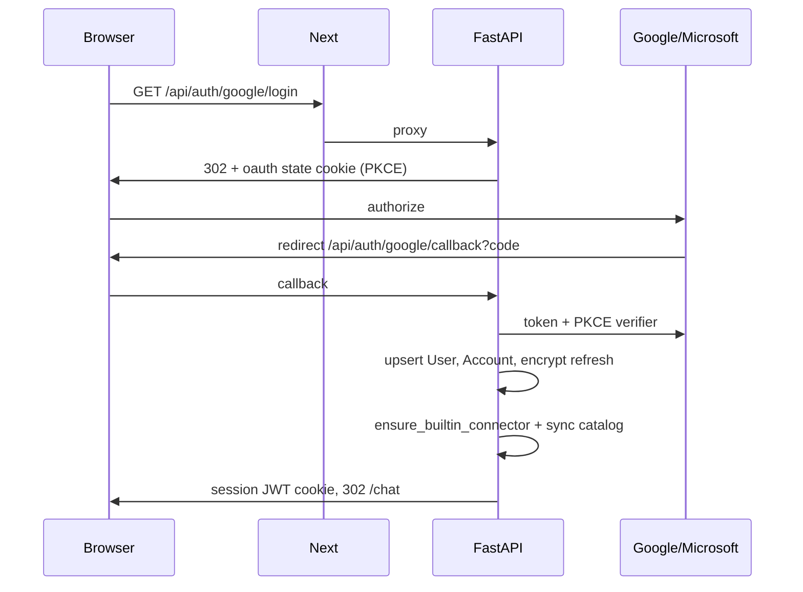
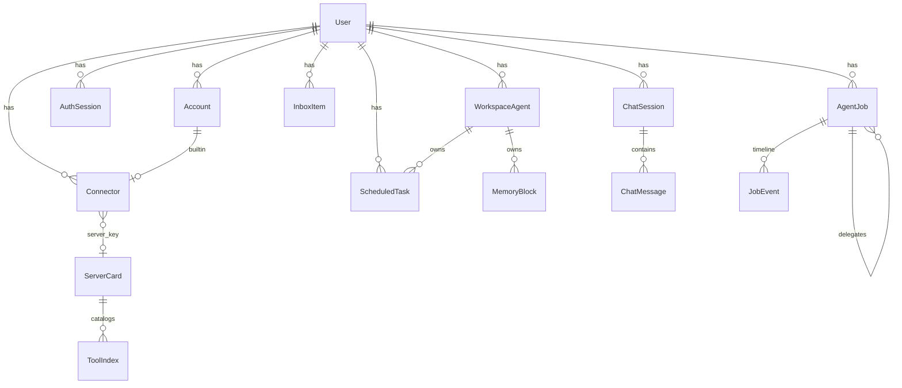
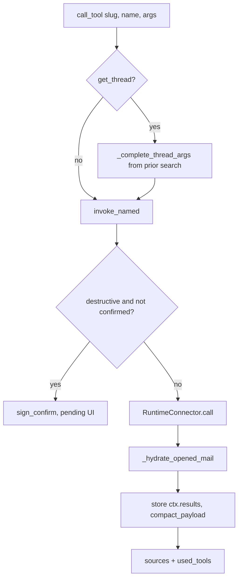
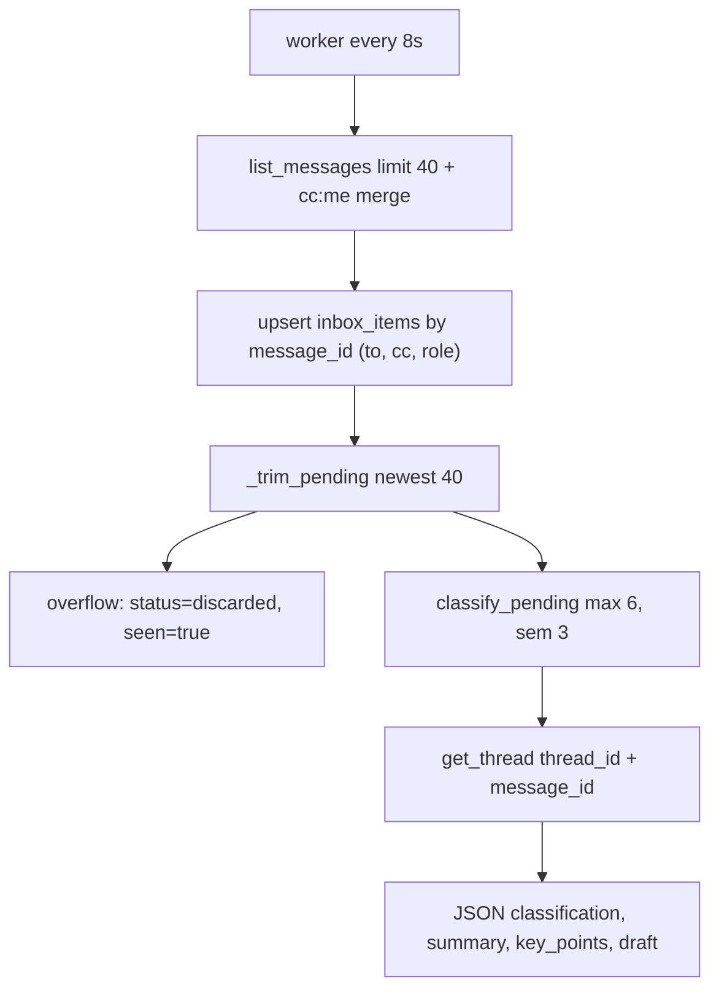

# Low-level design

Module-level design of Checkme: request paths, data model, agent loop, connectors, inbox, and files. Pair with [HLD](HLD.md) and [diagrams](diagrams.md).

## 1. Process and package map

```
apps/web
  app/page.tsx                 Sign-in
  app/chat/page.tsx            Chat + EmailThreadButton
  app/inbox/page.tsx           Triage UI
  app/connectors/page.tsx      Connector management
  app/tasks/page.tsx           Scheduled tasks
  app/components/AppShell.tsx  Nav, bell, SSE
  app/components/EmailThread.tsx
  app/api/[...path]/route.ts   Catch-all proxy to FastAPI
  lib/proxy.ts, lib/backend.ts Runtime API base URL

apps/api/app
  main.py                      FastAPI app, lifespan workers
  auth/                        OAuth + session
  chat/routes.py               Chat + GET /thread
  agent/deep.py                Harness agent (only chat path)
  agent/invoke.py              Named tool dispatch + confirms + files
  agent/attachments.py         Store blobs, extract, summarize
  inbox/                       Ingest, classify, SSE, batch, full thread
  tasks/                       CRUD + scheduler
  connectors/                  Registry, MCP client, runtime
  files.py, storage.py         Upload/download/PDF render
  models.py                    SQLAlchemy

packages/connector_core        ToolSpec, MAIL_CALENDAR_TOOLS, clean_body
packages/gmail_mcp             Gmail REST + Calendar
packages/outlook_mcp           Microsoft Graph
```

Startup (`apps/api/app/main.py` lifespan): `init_db` (create tables + `vector` extension) → `ensure_bucket` → sync builtin connector catalogs → `start_scheduler` + `start_inbox_worker`.

## 2. Web ↔ API

The browser only calls same-origin `/api/*`. Next forwards method, body, and Cookie; it strips hop-by-hop headers.

| Web route | Upstream |
| --- | --- |
| `POST /api/chat` | Dedicated `app/api/chat/route.ts` (120s) |
| `GET /api/inbox/events` | Dedicated SSE proxy, `maxDuration` 300, `X-Accel-Buffering: no` |
| Everything else `/api/*` | `app/api/[...path]/route.ts` → `proxyApi` |

API base: `API_INTERNAL_URL` in Compose (`http://api:8000`), `API_HOSTPORT` on Render. Never bake `localhost:8000` into a production image.

Session cookie is set by FastAPI on OAuth callback (`SESSION_COOKIE`, HttpOnly, Lax, Secure when `PUBLIC_WEB_URL` is https).

## 3. Authentication (LLD)



`current_user` (`deps.py`):

1. Read JWT → `sid`, `sub`.
2. If Redis `revoked:{sid}` → 401.
3. If Redis `sess:{sid}` miss, load `auth_sessions` and cache 300s.
4. Load `users` row.

Linking a second mailbox: `mode=link` + existing session; `link_user` in signed state. Duplicate provider subject on another user → `account_linked_elsewhere`.

Access tokens are not stored long-term. `account_access_token(account_id)` refreshes from the encrypted refresh token (`auth/tokens.py`).

## 4. Data model



| Table | Keys / notes |
| --- | --- |
| `users` | `id`, email, timezone default `Asia/Kolkata`, optional `letta_agent_id` (mirror of Chief’s Letta id) |
| `accounts` | Unique `(provider, subject)`. `refresh_token_enc` |
| `auth_sessions` | `expires_at`, `revoked` |
| `connectors` | Unique `(user_id, slug)`. `kind` builtin\|mcp, `provider` gmail\|outlook\|mcp, `health` |
| `server_cards` | PK `server_key` (`builtin:gmail`, `mcp:<hash>`). `core_tools`, `groups` JSON |
| `tool_index` | Unique `(server_key, tool_name)`. `search_tsv` generated, HNSW on `embedding` |
| `workspace_agents` | Named bot. `kind` `default` (Chief) or `custom`. Optional `letta_agent_id` — one Letta agent per workspace agent |
| `chat_sessions` | `state` JSON. `agent_id` / `group_id` file the thread under one agent or one group |
| `chat_messages` | `meta`: attachments, used_tools, pending_confirms, mail_threads, source |
| `inbox_items` | Unique `(user_id, message_id)`. `to_header`, `cc_header`, `recipient_role` (`to`\|`cc`\|`bcc`). `classification` reply\|respond\|discard, `status` pending\|sent\|discarded |
| `scheduled_tasks` | Index `(status, next_run_at)`. `agent_id` is the workspace agent that owns and runs the routine |
| `thread_summaries` | Cache for `summarize_thread` until `last_message_id` changes |
| `memory_blocks` | PK `(user_id, agent_id, label)`. Fallback core memory for that agent |
| `memory_passages` | Fallback episodic/archival rows, filtered by `agent_id` |
| `automations` | Staff routines. `agent_id` is the agent that created the automation |
| `commitments` / `admin_items` | Staff extractions. Still per user (not per agent) |
| `tool_usage` / `tool_edges` | Routing feedback |
| `agent_jobs` | Background runs (§10.1). `role` planner\|coder\|reviewer, `kind` chat\|delegate\|scheduled, `status` queued\|running\|waiting_approval\|waiting_children\|done\|failed\|cancelled, `parent_id` / `root_id` / `depth` (≤ 3), `meta` (history, next_query, confirmations, pending cards, children), `attempts`, `heartbeat_at` |
| `job_events` | Timeline rows for a job tree (`root_id`, id order): step, plan, diff, test, pr, message, approval, result, error, status, question, deploy |
| `deploy_credentials` | Unique `(user_id, platform)`. `credentials_enc` = Fernet JSON of the platform's env vars ([DEPLOY.md](DEPLOY.md)). Never returned by the API, never shown to the model |

`init_db` uses `create_all` plus `ALTER TABLE … ADD COLUMN IF NOT EXISTS` patches (inbox headers, chat `agent_id` / `group_id`, and per-agent memory/routine columns). No separate migration tool.

Startup backfill (`app/agents/scope.py`, applied from `db.py`): promote an existing agent named Chief to `kind=default` when the user has no default; insert Chief for users who still have unscoped memory, tasks, automations, or a legacy `users.letta_agent_id`; set `agent_id` on those rows to that user’s Chief and copy `users.letta_agent_id` onto Chief. Rows that already have an `agent_id` are left alone. Memory rows that still cannot be assigned are dropped. `memory_blocks` primary key becomes `(user_id, agent_id, label)`.

## 5. HTTP API (FastAPI, prefix `/api`)

### Auth / me

- `GET /auth/status` — which IdPs are configured
- `GET /auth/{google|microsoft}/login?mode=signin|link`
- `GET /auth/{provider}/callback`
- `GET /me`, `PATCH /me` (timezone)

### Chat

- `GET /chat/sessions`, `GET /chat/sessions/{id}`, `DELETE /chat/sessions/{id}`
- `POST /chat` — `{ message, session_id, confirmations, attachments, agent_id?, group_id?, progress_id? }`
- `GET /chat/progress/{progress_id}` — live status lines for an in-flight turn: `{ steps: [{ text, kind, tool, at }], done }` (see 6.5)
- `GET /chat/thread?slug&thread_id&message_id` — full bodies
- `POST /chat/attachments/summarize`

### Inbox

- `GET /inbox?live=1` — optional ingest, no mark_seen
- `GET /inbox/badge`, `POST /inbox/seen`
- `GET /inbox/events` — SSE every 2s; live ingest every 5 ticks
- `PATCH /inbox/{id}` draft, `POST .../rephrase|send|delete` (`send` body: `draft`, `attachment_keys`, `cc`, `bcc`, `reply_all`)
- `GET /inbox/{id}/thread`
- `POST /inbox/batch` — `empty_spam` / `empty_drafts` / `empty_trash` / clear discard / delete ids (`confirm`)

### Connectors / tasks / files

- `GET/POST /connectors`, `PATCH/DELETE /connectors/{id}`, `POST .../sync`, MCP OAuth start/callback
- `GET /connectors/marketplace`, `POST /connectors/marketplace/connect` — Composio app catalog + OAuth link
- Builtin platform connectors (when keys are set): `@computer` (E2B Desktop or Daytona sandbox, §7.2) and `@composio` (marketplace `find_tools` / `execute`)
- `GET /connectors/computer/status` → `{state, screenAvailable, url, title, screen_agent, provider, stream_url?, control_url?}` (never resumes a paused sandbox); `POST /connectors/computer/boot` wakes it and returns the same stream fields; `GET /connectors/computer/screen` is a PNG (E2B: real desktop screenshot; Daytona: the Chromium frame); `POST /connectors/computer/control` is the click/type takeover used by Daytona and by teaching
- `GET/POST /tasks`, `PATCH/DELETE /tasks/{id}`, `POST .../run`. `GET` accepts `agent_id` and `status`. `POST` body is `{ prompt, agent_id? }` — omitted `agent_id` uses Chief
- `POST /files/upload`, `GET /files?t=&render=`
- `GET /jobs?active=1` (root jobs), `GET /jobs/{id}`, `GET /jobs/{id}/events?after=` (whole tree: `{ root, jobs, events, waiting, done }`), `POST /jobs/{id}/approve|decline` `{ token }`, `POST /jobs/{id}/cancel` (cancels the subtree) — §10.1

Health: FastAPI `GET /health`, web `GET /up`.

## 6. Deep agent

File: `apps/api/app/agent/deep.py`. This is the **only** chat execution path.

### 6.1 Harness tools (what the model sees)

| Tool | Behavior |
| --- | --- |
| `list_connectors` | Enabled connectors for **this user**; mail connectors advertise mail+calendar core tools (never truncated) |
| `search_tools` | Capability query over `tool_index` (embed “Find a connector tool for: …”, OR prefix lexical). If the connector is a gateway, `search_tools` also runs `gateway__tool_search` and returns nested data tools. Catalog tools are scored down. Mail still injects `get_thread` / `empty_folder` / Meet/Teams. |
| `get_tool_schema` | JSON schema from the index, or `gateway__resolve` / a generic object schema for nested tools |
| `call_tool` | `invoke_named` / MCP / builtin. Nested names run through `gateway__execute`. |
| `inspect_result` | Slice stored `ctx.results` by path/search/offset |
| `schedule_task` | Staff persist on the speaking agent’s routines |
| `staff` | Briefing, inbox Q&A, commitments, voice |
| `list_agents_and_groups` | This user's Checkme agents and groups (ids, titles, members, 2–10 limit). Built in, not a connector |
| `create_agent` / `update_agent` | Create, rename, retitle, re-instruct, archive/restore a workspace agent via `agents/service.py` |
| `create_agent_group` | New group from member names/ids, or `all_agents=true` (all non-archived agents). Clear error under 2 or over 10 |
| `add_group_members` / `remove_group_members` / `rename_agent_group` | Edit an existing group; size rule re-checked |
| `delete_agent` / `delete_agent_group` | Never delete directly: return a confirmation card (see 6.4). Refused for Chief and for unattended (`auto_confirm`) runs |

System prompt rules that matter in production:

- Discover, then `call_tool`. Search with a capability phrase, not the user sentence. `search_tools` expands gateway catalogs; nested data tools are the answer, not `gateway__tool_search`. A dated snapshot is still an answer.
- Gmail/Outlook **are** calendar. Meet = `create_google_meet`, Teams = `create_teams_meeting`.
- After search, open/summarize mail with **`get_thread` + message_id**, never an empty `thread_id`. Cover CC’d mail (`recipient_role`). When sending, pass `cc` / `bcc` if the user named other people.
- Large results → `inspect_result`, do not stop at “truncated”.
- Future work → `schedule_task`. Clock-time meetings → `create_event` now.
- Connector answers are a **detailed analyst briefing**, not a short brief.
- Destructive tools still `call_tool`; the app confirms.
- Checkme's own agents/groups use the workspace tools above, never `search_tools`/`call_tool` or a third-party "group" (LiveChat, Slack…). After a change the reply says it is in the left sidebar under **Personal**. There is no group lead setting (the first member answers).

Recursion: `max_agent_steps * 8` (floor 80), retry twice up to 200 if LangGraph hits the limit.

### 6.2 `call_tool` internals



`invoke_named` (`agent/invoke.py`):

- `send_message` / `reply` / `forward` / `create_draft` load `attachment_keys` from storage into `files`. Confirm preview includes `to`, `cc`, `bcc`, `reply_all`.
- Virtual tools: `summarize_thread`, `summarize_attachments`, `read_attachment_text`.
- `get_message` / `get_thread`: hydrate attachment cards (preview URLs), do not dump bytes into the model.
- `empty_folder` / `bulk_delete`: first call may be preview `dry_run` for the confirm card; execution sets `dry_run=False`.

Payload size: default compact at 24k chars; `get_thread` / `get_message` at 60k. Over limit → `{ too_large, map, result_id }`.

### 6.3 Mail hydration

Triggers: user text contains open / summarize / thread / conversation / email / mail / inbox / briefing / read / pdf / attachment / …

On `search_messages`, `list_messages`, `list_threads`, `get_message`:

1. Take first hit’s `thread_id` + `message_id`.
2. `get_thread({ thread_id, message_id, max_messages: 50 })`.
3. If last message has files, `summarize_attachments`.
4. Attach `opened_thread`, set `thread_id` / `message_id` on the payload, record `slug__get_thread` in `used_tools`.

If the model later calls `get_thread` with an empty id, `_complete_thread_args` copies ids from the previous result.

Chat response meta includes `mail_threads: [{ connector_slug, thread_id, message_id, subject }]`.

### 6.4 Workspace (agents and groups) tools

File: `apps/api/app/agents/chat_tools.py`, wired in `harness_tools`. Agents and groups are referenced by id or name (case-insensitive, unique partial match), so the model can pass what the user said. Every mutation goes through `app/agents/service.py`, so the sidebar's rules apply (unique names, 20-agent cap, 2–10 members, Chief protected).

Deletes reuse the connector confirmation flow: `request_delete` signs `sign_confirm("tool", {slug: "__checkme_workspace__", tool: "delete_agent"|"delete_group", args: {id, name}})` and appends to `ctx.pending`. When the user presses Confirm, chat posts the token back; `run_deep_agent` sees the workspace slug in `confirmations` and runs `chat_tools.run_confirmed` (not `call_user_tool`). A teammate's pending cards are passed up to the lead's response.

Any successful mutation sets `ctx.workspace_changed`; `run_deep_agent` returns `workspace_changed: true`, the chat page fires `checkme:workspace-changed` on `window`, and `AgentsNav` refetches `GET /api/agents` so new agents/groups appear without a reload.

### 6.5 Live status narration

File: `apps/api/app/agent/progress.py`. The chat bubble no longer cycles canned phrases ("Thinking", "Checking connected sources", "Writing a reply"). Status text is derived from the agent's real events, with no extra LLM calls:

- The web app makes a `progress_id` per send (`turn_…`, `[A-Za-z0-9_-]{8,64}`) and posts it with `POST /chat`.
- The route builds a `ProgressReporter(user.id, progress_id)` and passes it to `run_deep_agent(progress=…)`, which puts it on `RunContext.progress` and adds a `ProgressCallback` to the graph's `ainvoke` config `callbacks`. LangGraph forwards callbacks to every model and tool call (harness tools and deepagents built-ins such as `write_todos`, `read_file`, `task`).
- `on_tool_start` → `describe_tool(name, args, connector_names)`: e.g. `call_tool(gmail, GMAIL_SEARCH_MESSAGES, {query})` → "Gmail: search messages for “invoice”", gateway `tool_search` → "Finding the right GitHub tool for “…”", `browser_navigate` → "Opening example.com in the browser", `create_agent_group` → "Creating the group “Crew” with all your agents", `ask_teammate` → "Asking Dev: …", `write_todos` → "Next: <in-progress todo>". Unknown tools fall back to the humanized tool name plus its key argument.
- Model events: first model call → "Working out how to handle “<request>”"; a model call after tools → "Going over what <connector> returned"; an AI message with tool calls and text → its first sentence (the model's own narration); a final AI message → "Writing the reply". Tool errors → "<tool> hit an error, trying another way". Confirmed actions → "Running what you confirmed: …".
- Teammate runs get `progress.child(name)`, which prefixes lines ("Dev: GitHub: create pull request") and passes them explicit callbacks, so the parent's handler does not double-report.
- Lines are de-duplicated, clipped to 140 chars, and `RPUSH`ed to Redis `chatprog:{user_id}:{progress_id}` (TTL 900s, max 60). Redis failures are swallowed; the turn still completes. The route's `finally` appends a `done` step. The step texts are also saved on the assistant message as `meta.steps`.
- `GET /chat/progress/{id}` reads only the caller's own key. The chat page polls it every 1.2s while that scope is busy (`pollProgress` in `app/chat/page.tsx`) and `Thinking.tsx` shows the latest line with the previous three as a ✓ trail. Before the first line arrives it shows "Starting on “<your message>”".

### 6.6 Agent focus (new-agent onboarding)

Files: `apps/api/app/agents/focus.py`, `apps/api/app/agent/coding.py`, `apps/web/app/components/FocusCard.tsx`.

- `workspace_agents.focus` (`VARCHAR(40)`, ad-hoc `ALTER` in `db.py`) is one of `email_calendar | coding | research | errands`, or `""` when it isn't set. `POST /agents` and `PATCH /agents/{id}` accept `focus`. Labels and aliases are normalized ("Coding and deployments", "dev" → `coding`), and unknown values return 400. Setting a focus on an agent with no title also gives it a default title (e.g. `software engineer`). `serialize_agent` returns `focus` and `focus_label`.
- **Card:** a custom agent with no focus, on an empty chat, shows a greeting bubble ("Hi <first name>, I'm <agent>. Happy to be here, and I'd love to get a sense of how I can make your days easier."). Below it is the dismissible card "What would you most like a hand with?" with A Email and calendar, B Coding and deployments, C Research and writing, D Errands and bookings, and the hint "Or answer in the chat below". The existing hero cards stay underneath. Picking an option calls `PATCH /agents/{id} {focus}` and then sends the option's answer as the user's message. Dismissing the card is saved in localStorage per agent. Chief (`kind=default`) and groups never show it.
- **Free answer:** a custom agent with no focus and no instructions gets `UNSET_PROMPT` and the `set_my_focus(focus)` harness tool, so a typed answer also sets the focus (`workspace_changed` refreshes the sidebar).
- **Prompt:** `system_prompt` appends `focus_prompt(agent)` after the agent's instructions. Email/calendar and errands get light defaults. Research gets: browser or web_fetch, at least three sources, inline [n] citations plus a Sources list, then outline and draft.
- **Coding (`focus=coding`), a general-purpose coding agent:** the prompt (`focus.py`) follows the same loop Checkme's own engineer uses:
  1. **Ack, then one result.** The first line names the first step (`coding.first_step`, e.g. "On it: first I'll explore octo/app and write a todo list"); the job ends with one message: PR link, what changed, checks, caveats.
  2. **Todo list first.** `write_todos` before anything else; the timeline shows it as a checklist (`plan` events carry `data.todos`), and progress lines are only for milestones.
  3. **Explore remotely first** with the Composio GitHub reads (`composio-github`: `list_branches`, `get_tree`, `get_file`, `search_code`, `list_commits`, `compare_refs`, `blame_file`, PRs, issues). Without a connection it falls back to `git_checkout` + `git_inspect` on the computer.
  4. **Build on the computer:** `ensure_dev_toolchain` → `git_checkout` (branch `agent/<short-name>`) → `repo_overview` before editing → `find_symbol` / `find_references` / `read_file_range` → edit → `run_checks` until green (≤3 runs) → `git_commit` → `push_branch` (approval card).
  5. **PR, then "Merge it?".** The PR body gets a `## Tests` table from the latest `run_checks`. It does not merge by default: a root chat job ends `waiting_input` with *Merge it?* (Yes / No). Only an explicit yes (or an approved card) leads to `check_merge` → `merge_pull_request(head_sha=<from check_merge>)` (card), and the reply reports the merge commit sha.
  6. **Option cards** (`ask_user(question, options, waiting_for?)`) when something is ambiguous: repo, base branch, merge method.
  7. **Per-agent coding memory** (`coding_memory.py`): a `coding` core block with the default repo, recent repos, recent PRs and conventions (branch, commit style, test and lint commands), updated by `remember_coding` and automatically after a PR or merge.
  8. **Blocked auth:** when GitHub is not connected through Composio and the sandbox has no credentials, `push_branch` saves the work as patches in `~/work/_patches/<repo>-<branch>/` before any card, returns `status=blocked` with what is missing (Connectors → GitHub (Composio) → Connect GitHub), and the agent asks with `waiting_for='github'`. `GET /api/connectors/github/status` resumes those jobs once connected (`github_status.resume_blocked_jobs` → `service.resume_waiting_for`, also for legacy `github_app` waits).
  9. **Follow-ups continue the same job** (§10.1).

  Pushes stay on `agent/*`, except a user-named, verified existing PR branch (`push_branch(..., pr_number=N)`: the PR must be open and not from a fork), still behind the card. Deploys go through a deploy connector (Render MCP, Vercel, …) if there is one, else the platform CLI on the computer (`deploy`, `deploy_rollback`, `deploy_status`, `deploy_logs`, `detect_deploy_targets`; see [DEPLOY.md](DEPLOY.md)). Deploy and rollback always show an approval card, and the credentials are never shown to the model. If something is missing, the agent says exactly what. Extra harness tools exist only for coding agents:
  - `coding_workspace_status`: one sandbox `exec` probe (git, gh, `gh auth`, credential helper, node, python, rg, ctags, the `~/.checkme/toolchain-v1` marker, `~/work`) plus a connector scan (GitHub by slug/provider/name/tags, deploy hints, Composio). It returns `can`, `missing`, `workdir`, `toolchain`, `dev_toolchain`, `github_connectors` and `deploy_connectors`.
  - `sandbox_shell(command, cwd?, timeout=300)`: `call_user_tool(computer, exec)` with a 10–900s timeout. Without a computer it returns the "computer is not available" message (needs `E2B_API_KEY` or `DAYTONA_API_KEY`).
  - Coding agents get `recursion_limit ≥ 200` (retries up to 280; teammate runs up to 120).
  - Permissions are unchanged: sandbox `exec` isn't destructive, so it runs without a card, and destructive connector tools still use the confirmation card.

### 6.7 Coding git tools (safe git on the sandbox)

Files: `apps/api/app/agent/git_tools.py`, `apps/api/app/agent/coding.py`. These are coding agents only, next to `sandbox_shell`. `sandbox_shell` stays available for reading and editing files, but its description steers git work to these tools.

| Tool | What runs on the computer |
| --- | --- |
| `git_checkout(repo, branch?, base?)` | Installs git if it's missing, then clones or fetches into `~/work/<name>` over plain `https://github.com/o/n.git`. The branch is reused locally, tracked from the remote, or created `--no-track` from `origin/<base>`. Without a usable git token, a failed private clone falls back to a Composio snapshot (`auth=composio_snapshot`, tarball through the proxy, no history). |
| `run_tests(repo, command?, timeout=600)` | Auto-detects `npm test`, `uv run pytest` / `python3 -m pytest`, `go test` or `cargo test`. Returns `passed` and the output tail. |
| `git_diff(repo, base?)` | Status, commits not on base, diffstat and diff (clipped). |
| `git_inspect(repo, action, path?, query?, ref?)` | Read-only: `status`, `log`, `branches`, `ls`, `read`, `grep` (fixed-string `rg`), `show`. Arguments are validated; nothing writes. |
| `git_commit(repo, message, paths?)` | Refuses the default branch; otherwise only `agent/*` (or the verified PR branch). Author is the connected GitHub user's name and `<id>+<login>@users.noreply.github.com` (from `GET /user` through Composio), otherwise `Checkme Coder`. |
| `push_branch(repo, branch, open_pr=true, title, body, base?, draft?, pr_number=0)` | Only `agent/*`, or the head branch of open PR `pr_number` in the same repo (verified through Composio GitHub, no forks). A missing-credentials preflight runs first (see blocked auth above). **Always** creates an approval card (slug `coding`, ttl 3 days), even when `auto_confirm` is on. The card preview lists commits and diffstat. On approval, `run_deep_agent` replays the push through `git_tools.run_confirmed`, which pushes (`git push refs/heads/B:refs/heads/B`, never `--force`, when a git token is available; otherwise the git data API through the Composio proxy, non-force and pinned to the base sha) and opens the PR through Composio GitHub. One approval covers the push and the PR, and only for that exact repo and branch. |

**Token handling.** GitHub API calls go through Composio Proxy Execute, so Checkme never holds a token for them. For sandbox git, `github.git_token` reads the connected account's OAuth token and uses it only when Composio returns it unmasked (custom OAuth auth config, "Mask Connected Account Secrets" off). The token goes only in Daytona exec `env` as `CHECKME_GIT_TOKEN`, and git reads it through a one-shot `-c credential.helper= -c 'credential.helper=!f() { echo username=x-access-token; echo "password=${CHECKME_GIT_TOKEN}"; }; f'`. It never appears in the command string or the clone URL. Nothing is written to `.git/config` or a credential store, and checkout also resets `origin` to the plain URL. These tools call `RuntimeConnector.exec` directly, not `call_user_tool`, so the env never reaches `ctx.results`, sources, the DB or debug logs. Output is scrubbed of the token and of any `gh*_`/`github_pat_`/`x-access-token:` pattern before the model sees it.

**API push (masked token).** `push_bundle_script` writes `~/work/_push/<name>-<branch>.json` (changed files as base64 with modes, deletions, the GitHub parent sha from `.git/checkme-map`); the server reads it with the internal Daytona `read_bytes` tool and calls `github.commit_files(parent_sha=…)`: blobs → tree → commit → non-force ref update. The parent pin refuses the push if the remote branch moved. `mark_pushed_script` records the local→GitHub sha mapping. Local commits become one GitHub commit; submodules and symlink-to-directory edits are not supported.

**Fallback without a Composio connection.** Checkout runs anonymously, which works for public repos, or uses whatever `gh auth` / credential helper the sandbox already has. Push then uses the sandbox credentials. If those fail, the result says to connect GitHub in Connectors → GitHub (Composio), or points to the GitHub MCP tools (whose writes are still gated, §7).

### 6.8 Coding IDE tools (`app/agent/dev_tools.py`, `app/agent/sandbox/overview.py`)

| Tool | What it does |
| --- | --- |
| `ensure_dev_toolchain(extras?, force?)` | Idempotent bootstrap on the computer: git, curl, ripgrep, fd, jq, tree, universal-ctags, gh (apt or the release tarball into `~/.local/bin`), node with pnpm/yarn, python3, uv, pytest; `go` / `java` / `rust` on demand. Sets the git identity only if unset. Writes `~/.checkme/toolchain-v1` (present / failed / extras) so later calls return `cached=1`; asking for a new extra re-runs it. |
| `repo_overview(repo)` | Runs the stdlib-only `overview.py` on `~/work/<repo>`: languages, frameworks, entry points, manifests, CI files, README head and the check commands by kind (setup, lint, typecheck, unit, integration, build). CI `run:` steps come first (with `working-directory` and `run: \|` blocks), and manifest commands fill gaps for the same kind and directory. Cached on the run as `ctx.overviews`. |
| `find_symbol(repo, symbol, kind?)`, `find_references(repo, symbol, path?)`, `read_file_range(repo, path, start, end)` | ctags + an `rg` definition regex; `rg -w -F` with a match count; a numbered line range. Symbols and paths are validated. |
| `run_checks(repo, kinds?, commands?)` | Plans setup for the involved directories, then each check with `CI=1`; returns a pass/fail table and, on failure, "attempt k of 3" guidance. Results are a `test` timeline event (`data.table`) and go into the PR body (`pr_body_with_tests`). |
| `review_pull_request(repo, number, verdict, summary, findings[])` | Reads the PR files through the App, posts findings on changed lines as inline comments (others go in the body with `path:line`) and submits APPROVE / REQUEST_CHANGES / COMMENT with `create_review`. The reviewer role uses it. |

**Readiness.** `coding_workspace_status` adds `github {via, configured, connected, login, git_transport}`. When GitHub is not connected and no other GitHub route exists, `missing` says to connect it in Connectors → GitHub (Composio). The coding prompt asks a new coding agent's first reply to report GitHub, computer and deploy status.

**Coder seed.** `users.coder_seeded` (ad-hoc `ALTER`) is checked once per user by `agents.service.ensure_coder_agent`, called from `list_workspace`. It creates `Coder` (focus `coding`, title `software engineer`). If an agent named Coder, or any agent with a coding focus, already exists, it only sets the flag. Deleting the Coder later is respected.

**Daytona image (checked against `daytonaio/daytona` `images/sandbox*/Dockerfile`, not in a live sandbox).** The cloud default snapshots (`daytona-small/medium/large`) are built from `mcr.microsoft.com/devcontainers/python:3.14`, which is based on the full `python:3` / buildpack-deps image and includes **git**, Python 3.14, and Node 25 through nvm (`/usr/local/share/nvm`), plus `uv` and `ripgrep`. `gh` is **not** included. The self-hosted `*-slim` image is `python:3.14-slim` with Node 22 through nvm, and has **no git** (daytona#4437). Commands run as the non-root `daytona` user with passwordless sudo, and Daytona `exec` uses **zsh** in the default snapshots. So every git tool wraps its script in `bash -c` with `set -o pipefail`, sources nvm itself (non-interactive shells don't), and `git_checkout` runs `sudo -n apt-get install -y git` when git is missing. There is one sandbox per user, so jobs that touch it are serialized per user (§10.1).

### 6.9 Deploys (`app/agent/deploy.py`)

`detect_deploy_targets` probes the deploy configs (render.yaml, vercel.json, fly.toml, netlify.toml, railway, serverless / SAM / CDK, app.yaml, azure.yaml, Dockerfile) and returns a route per platform (`connector` / `cli` / `connect`). `deploy` and `deploy_rollback` validate the params (allow-list and regex) and `cwd`, prefer a connector (`use_connector`), and otherwise return `blocked` with `/connectors?deploy=<key>` (then `ask_user(waiting_for='deploy_<key>')`) or create a `kind=deploy` card (`slug=coding, tool=deploy_action`, exact args). The card is replayed through `git_tools.run_confirmed` → `deploy.run_action`, which loads the `deploy_credentials` row (Fernet), passes it as exec env only (`sandbox_exec(env=…)`, scrubbed with `secrets_of`), installs the CLI if needed, and records a `deploy` event with the URL. `deploy_status` / `deploy_logs` are read-only, with no card. Connector deploy writes are gated by `git_write_gate` → `is_deploy_write`. Credentials API: `/api/connectors/deploy` (GET names, PUT, DELETE; PUT resumes waiting jobs). Details: [DEPLOY.md](DEPLOY.md).

### 6.10 Agent profile, skills and teach-by-demonstration (`app/skills/`)

**Profile + skill index (every turn, every agent, 1:1 and group).** `run_deep_agent` loads all of the agent's skills (`list_skills`: the agent's own plus unassigned ones) and `system_prompt` injects `profile.capabilities_block`:
- identity: name, title, focus (plus the agent's instructions and focus prompt above it);
- a complete skill index, one line per skill: `name [taught|saved, id]: when to use` (first sentence of the instruction). Skills still `recording` are left out; `writing` ones are marked. Capped at 40 lines;
- for questions *about* the agent ("what skills do you have", "what can you do", "who are you", `profile.is_meta_question`) an explicit "answer from this profile, do not run a skill or continue an earlier task";
- the full body (≤2400 chars) only of the skills routed to this request.

The block is rebuilt from the database on each turn; nothing caches the prompt, so a skill created, renamed, edited or finished by the background write-up is visible on the next turn. Embeddings for routing are cached in Redis by text hash (`llm.embed_texts`), so a changed skill text gets a new vector automatically.

**Routing (`profile.route_skills`).** Keyword prefilter that ignores generic words (`skill`, `what`, `you`, …) plus cosine similarity of `text-embedding` vectors (query vs `name: instruction`), threshold 0.42; keyword-only when embeddings are unavailable; never for meta questions. Up to 2 skills, each tagged `match: {score, by}`. The turn emits "Skill for this task: …" to live progress and returns `skills_used` (stored in the assistant message meta). Tools: `list_my_skills` (index with ids) and `get_skill` (full instructions, steps, transcript; emits "Using skill: …"). The prompt tells the agent to say which skill it is using and to ignore a routed skill that does not fit.

*Bug this fixes (Oct 28):* the old `match_skills` scored any word ≥3 letters, so "What skill you have" matched "Yc skill" on the word "skill", and the prompt said "when a request matches one, follow its instructions"; with the Anjuna bike-rental task in the recent history the agent re-ran that research instead of answering.

**Teaching is saved while it happens.** `POST /skills/teach/start` creates the `agent_skills` row at once (`kind=taught`, `status=recording`, `name="Taught workflow"`, `auto_named=true`). A flush loop (every 5 s) writes the merged, narration-aligned timeline (rail input + in-desktop capture via `recorder.peek` + transcribed narration), the transcript, key screenshots (base64 JPEG in `frames`, only when changed), notes and duration into that row. Typed text that looks secret (password/OTP/PIN/card context, 6–8 or 13–19 digit numbers, password-shaped tokens) is replaced by `•••• (hidden, N characters)` before it is stored or sent to the LLM.

**Stop returns immediately.** `POST /skills/teach/stop` marks the row `writing` (and applies a user-chosen name) and returns `{id, status:"writing"}`. A background job stops the recorder, waits ≤90 s for transcripts, stores the final recording (or deletes the row if nothing at all was recorded), then `write_up`: the LLM (screenshots + timeline, 75 s timeout, 2 attempts, then text-only; "JSON" is in the *input* because the Responses API rejects `json_object` otherwise). On success it sets the instruction and, if still auto-named, the generated name. On failure it writes a deterministic numbered step list, an auto name (first spoken sentence or main window title), `status=ready` and `error` with the reason. `POST /skills/{id}/rewrite` re-runs it (Retry).

**Restarts.** The in-memory session is lost on deploy, but the row is not: stop with no in-memory session finalizes the user's latest `recording` row; `list_skills` housekeeping finalizes orphaned `recording` rows (>60 s without a flush), turns stale `writing` rows (>3 min, no job) into `ready` + error, and deletes empty default-named taught rows.

**Recorder fix.** The in-desktop capture was never starting because `pkill -f /tmp/checkme_teach.py` matched the `bash -c` that ran it and killed it (exit 143 → `CommandExitException`). Patterns are now bracketed (`/tmp/[c]heckme_teach.py`) and start is retried 3×.

**API.** `GET /skills?agent_id=` (list, adds `status`, `error`, `step_count`, `frame_count`), `GET /skills/{id}` (full: steps, transcript, notes, frame indexes), `GET /skills/{id}/frames/{i}` (JPEG), `PATCH /skills/{id}` (name, instruction), `DELETE /skills/{id}`, `POST /skills/{id}/rewrite`.

**UI.** Agent settings → Skills: each skill is a button with status chips (recording…, writing skill…, write-up failed) and refreshes every 3 s while any is busy. Tapping opens `SkillDetail` (full-screen sheet on phones): rename, edit instructions, Save, Re-run write-up, Delete (confirm), recorded steps, narration, screenshots. The screen panel polls the taught skill after Stop and updates its notice (ready / failed + Retry write-up / nothing recorded); a stop that finds no session leaves teaching mode instead of sticking.

### 6.11 Per-task skill state and handover (`app/skills/task_state.py`)

Each task records which skill it is following and how far it has got. The state is saved after every change, so a restart or a handover never loses progress.

- **What a task is.** The `task_key` keeps concurrent work separate:
  - `job:<job id>` is a background job. Each attempt and each resume after a restart reuses the same key.
  - `chat:<session>:<agent>` is one agent's thread in a chat. Group chats get one key per agent.
  - `peer:<state id>:<agent>` is a teammate working on a handed-over part.
- **Row.** Each task has one row in `task_skill_states`:
  - task: `task_key`, `session_id`, `job_id`, `agent_id` and `parent_id`;
  - skill: `skill_id`, `skill_name` and `skill_version` (the skill's `updated_at` when it was chosen);
  - progress: `status` (active | handed_off | done | failed | dropped), `step_index` and `step_count` (numbered lines in the instruction, or the number of recorded steps);
  - output: `notes`, `artifacts` and `result`.

  Every write runs in its own short session through `STORE`, so each write is a checkpoint. Tests swap in an in-memory store.
- **Choosing the skill.**
  - `route_skills` (6.10) proposes candidates using keywords and embeddings.
  - `confirm_skills` then asks the LLM, in JSON mode with "JSON" in the input, which of them the request actually asks to perform. If no API key is set or the call fails or times out (12 s), the routed list is kept as it is.
  - Meta questions never get here.
- **Opening or resuming state** (`begin`).
  - Jobs and peer tasks keep their state for life, even if a later attempt routes to a different skill.
  - In a chat, a newly routed skill replaces the old state, which is marked `dropped`.
  - A chat follow-up that routes no skill resumes the active state if it is under 6 h old. Meta questions never resume.
  - When the agent loads a skill itself with `get_skill`, that also opens the state.
- **Prompt.**
  - `prompt_block` adds a "Task state" section: the skill and its version, how many steps are done and which is next, recent notes and artifacts, and "do not redo finished steps" when resuming.
  - The agent calls `skill_progress(step, note, artifact_label, artifact_value, done)` after each step.
- **Narration and timeline.**
  - Chat: the status line shows "Using skill: X · step 2/5" or "Resuming skill…". The reply's meta holds `task_state`, and the web UI shows "Skill: X · 2/5 steps" under it.
  - Jobs: the timeline gets a `status` event with `data.skill_state`. `JobTimeline` shows a chip per agent with the skill and current step, including "handed over" and "done".
  - `GET /skills/tasks/states?session_id=|job_id=` lists the states.
- **Handover.**
  - `delegate` (in background jobs) and `ask_teammate` (in groups) call `handover`. It creates a child state for the receiving agent with the same skill, step, notes and artifacts plus a "handed over by" note. The parent is marked `handed_off`. A delegated job's id goes into `meta.skill_state_id`.
  - The receiver's run resumes that state, and the prompt tells it the task was handed over.
  - When the receiver finishes, `finish` writes the result back to the originating task: a "Result from X" note, the furthest step reached and the merged artifacts. The parent becomes `active` again.
    - `ask_teammate`: the result comes back at the end of the nested run.
    - Delegated jobs: `jobs.service.after_terminal` calls `finish_job`, and then the parent job resumes as usual with the result in its state.

### 6.12 WhatsApp channel (`app/channels/`)

- `provider.py`: `ChannelProvider` protocol with two implementations, chosen by `choose()` (`WHATSAPP_PROVIDER`,
  else Twilio when `TWILIO_ACCOUNT_SID` is set, else Meta):
  - `TwilioWhatsApp`: REST `Accounts/{sid}/Messages.json` (API key or SID + auth token basic auth), form-encoded
    inbound `parse` (Body, ButtonPayload, MediaUrl0), `twilio_signature` / `validate` (HMAC-SHA1 of the public
    URL + sorted fields), 1600-char split, quick-reply Content template or text fallback for buttons, Content
    template for the out-of-window notice, media download from `api.twilio.com` only;
  - `MetaWhatsApp`: Graph `/{phone_number_id}/messages` and `/{media_id}`, `check_signature` (HMAC-SHA256 of the
    raw body against `X-Hub-Signature-256`), `parse` (text / interactive / button / media).
  - Both expose `kind`, `text_max`, `business_number()` and `notify_template()`; plus `e164`.
- `routes.py`:
  - Twilio webhook: `POST /api/channels/whatsapp/twilio` (signature over `WHATSAPP_PUBLIC_BASE_URL` + path, claim
    `MessageSid`, BackgroundTask, empty TwiML) and `POST /twilio/status` (optional delivery status);
  - Meta webhook: `GET /api/channels/whatsapp/webhook` (hub verify) and
    `POST /api/channels/whatsapp/webhook` (signature, then claim the message ID in `channel_inbound`, then a
    BackgroundTask);
  - signed-in endpoints: `GET /api/channels/whatsapp`, `POST /link-code`, `DELETE /links/{id}`.
- `service.py`:
  - linking: `ChannelLinkCode` (6 chars, 15 minutes, single use) becomes a `ChannelLink`, with the address unique
    per channel;
  - commands: `parse`, plus fuzzy `match_name`;
  - `route_message`:
    - agent order: target, then sticky, then room lead, then default;
    - thread: a `ChatSession` with `state.channel="whatsapp"`;
    - job handling: `followup` / `answer` on the latest chat job when it is queued, running or waiting; otherwise
      a new `kind=chat role=worker` job whose history comes from the previous job;
    - `job.meta.channel = {link_id, address, inbound_at, show_name}`.
  - approvals: buttons `wa:ap|dn|op:<job>:<i>` call `jobs.approve` / `decline` / `answer` after
    `job.user_id == link.user_id`.
- Runner hooks:
  - `run_job` calls `_notify_channel` after it commits, which calls `after_run`. That uses `outcome_parts`
    (answer chunks, approval buttons, question options, attachments as media) and `deliver`: send inside the 24h
    window, otherwise outbox plus the optional template.
  - `JobProgress._write` calls `progress` (plan/status only, rate-limited per job).
- Formatting: `formatting.to_whatsapp` and `chunk(provider.text_max)` (4096 Meta, 1600 Twilio), which closes and reopens code fences across a split.
- Tests: `tests/test_whatsapp.py`, `tests/test_whatsapp_twilio.py` (pure) and `tests/test_whatsapp_db.py` (Postgres).

## 7. Connector runtime

`RuntimeConnector.call(name, args)`:

- **builtin** `gmail` / `outlook`: instantiate package connector with `account_access_token`, `BaseConnector.call` → `tool_{name}(**accepted args)`. Extra keys (e.g. `full`, `message_id`) are passed if the method signature has them.
- **mcp**: decrypt creds, refresh OAuth if needed, `call_mcp_tool(server_url, creds, name, args)`.

Gmail and Outlook share `MAIL_CALENDAR_TOOLS` in `connector_core/mail_tools.py` (identical names). API-side extras in `connectors/virtual.py`: `summarize_thread`, `summarize_attachments`, `read_attachment_text`.

- **builtin** `composio_github` (`connectors/github.py`, slug `composio-github`): GitHub through the user's Composio connected account. `account_for(user)` lists `GET /api/v3.1/connected_accounts?toolkit_slugs=github&statuses=ACTIVE` (newest first, or the one on `COMPOSIO_GITHUB_AUTH_CONFIG_ID`; cached 60s). Every GitHub call is `POST /api/v3.1/tools/execute/proxy` with that account (GitHub `Accept` / API-version headers as header parameters); inner status ≥400 raises `GitHubError(status)`. Reads: `list_repos` (`/user/repos`), `list_branches`, `get_tree`, `get_file`, `search_code`, `list_commits`, `get_commit`, `compare_refs`, `blame_file`, `list_prs`, `get_pull_request` (files with patches), `get_pr_comments`, `list_issues`, `get_issue`, `check_merge` (mergeable state, conflicts, checks, statuses, `head_sha`). Writes: `comment_pull_request`, `create_review`, `request_reviewers`, plus the destructive `create_pull_request`, `update_pull_request`, `push_files` (`agent/*` only, git data API, text or base64 content, modes, never forced) and `merge_pull_request(repo, number, head_sha, method=merge|squash|rebase, delete_branch?, allow_failing_checks?)`. A merge requires the reviewed `head_sha`, refuses if the branch moved, re-checks mergeability (conflicts refused with the state spelled out, failing checks refused unless `allow_failing_checks`) and sends `sha=head_sha` to GitHub. The merge card shows a live preview (`preview_live`: ready / conflicts / checks / moved head). An approval covers only the exact repo, number, method, `delete_branch` and `head_sha` (`deep._approved`). `create_pull_request` / `merge_pull_request` results are tracked on the run (`ctx.prs`, `ctx.merged`). Routes `/api/connectors/github/{status,connect}`. The row is created by `ensure_platform_connectors` when `COMPOSIO_API_KEY` is set; legacy `github_app` rows route here and the built-in `github-app` row is disabled (the `github_installations` table is kept, unused). Setup: `docs/GITHUB.md`.
- **Git-write gate** (`deep.git_write_gate` → `github.is_git_write`): Composio GitHub write tools, generic Composio `GITHUB_*` write slugs, and any GitHub/GitLab connector tool named like merge/push/create PR/commit/update file, need a confirm card even when `auto_confirm` is true.

### 7.1 Outlook `get_thread`

Problem: Graph `$search` often omits `conversationId`, so the agent used to call `get_thread` with an empty id and return **one** message (the latest reply). Quoted history was also stripped (`clean_body` default).

Resolution (`packages/outlook_mcp/.../connector.py`):

1. `_ensure_conversation_ids` on list/search: GET missing `conversationId`.
2. `_summary.thread_id` = conversationId or message id (never null).
3. `_resolve_conversation(thread_id, message_id)`:
   - GET message if `message_id` or Graph message-shaped id (`AAMk…`)
   - Subject-like strings → search, then GET
   - Else use `thread_id` as `conversationId` (`AAQk…`)
4. `_messages_by_conversation`:
   - `$filter=conversationId eq '…'` + `ConsistencyLevel: eventual` + `$count`, **paginate**
   - If ≤1 row: KQL `conversationid:`, then per-folder filter (inbox, sentitems, deleted, archive, junk, drafts)
   - If still ≤1: `$search` subject core, match conversation or normalized subject
   - Merge seed message
5. `full=true` or single message → `keep_quoted=True`, body limit 20k; else 2500.

Gmail: `GET /threads/{id}` after resolving `threadId` from `messages/{id}` or from a subject search. Same `full` / quoted rules.

`reply` extra recipients: Gmail composes To from Reply-To/From, merges Reply-all To/Cc plus extra `cc`, and sets `Bcc`. Outlook uses `reply` / `replyAll` when there are no extras or files; otherwise `createReply` / `createReplyAll`, PATCH merged `ccRecipients` / `bccRecipients`, attach, then send. `send_message` already takes `cc` and `bcc` on both providers.

`GET /api/inbox/{id}/thread` and `GET /api/chat/thread` always pass `full=True`, `max_messages=100`.

### 7.2 The computer: E2B Desktop (default) or Daytona

Files: `app/connectors/daytona_box.py` (all computer tools, `call_daytona`), `app/connectors/e2b_box.py` (E2B backend), `app/connectors/computer_daemon.py` (Chromium daemon inside the sandbox).

- **Backend choice.** `Settings.computer_backend`: `COMPUTER_PROVIDER=e2b|daytona` when that provider's key is set, else E2B whenever `E2B_API_KEY` is set, else Daytona. The connector keeps provider id `daytona` (slug `computer`) for both, so agents, prompts and tests see one computer; `call_daytona` picks the backend.
- **Adapter.** `e2b_box.E2BComputer` mimics Daytona's sandbox: `process.exec(cmd, cwd, env, timeout)` → `{exit_code, result}` (stdout+stderr; non-zero exits and timeouts become exit codes), `fs.download_file / upload_file / list_files`. Default cwd is `/home/daytona` (created and chowned on the E2B desktop) so paths in tools and prompts are unchanged. The E2B SDK is sync; every call runs in `asyncio.to_thread`.
- **Per-user persistence.** The sandbox id and the noVNC password are stored encrypted in the computer connector's credentials (`e2b_sandbox_id`, `e2b_stream_key`) and written to the DB immediately; E2B metadata `checkme_user=<id>` is a backup lookup. `ensure_sandbox`: in-process handle → `Sandbox.connect(id)` (resumes a paused sandbox with memory, so background processes come back) → create. A missing sandbox (`NotFound`) is recreated. Sandboxes are created with `lifecycle.on_timeout=pause`, timeout `E2B_SANDBOX_TIMEOUT` (default 3600 s), and each tool call extends it (keepalive, throttled to once a minute).
- **Background processes.** `exec` rewrites `nohup` to `setsid nohup` so jobs (browser daemon, `launch_app`, dev servers) leave the command's process group and survive between tool calls; pause/resume keeps them.
- **Desktop and stream.** Xvfb `:0` 1280×900 + XFCE. The stream is x11vnc + noVNC on port 6080 with a random password; `stream_url` is view-only, `control_url` accepts input. The browser daemon runs Chromium **headed** on `:0` (`CHECKME_BROWSER_HEADED=1`) so the agent's browsing is visible in the stream; on Daytona it stays headless and the UI polls PNG frames.
- **Daemon version.** `_daemon_up` compares the health JSON with `computer_daemon.VERSION`; a stale daemon is restarted once, a current one is reused (a hard-coded `"9"` after the bump to `"10"` restarted Chromium on every call and lost the page).
- **UI.** `ScreenRail` embeds `stream_url` in an iframe (pointer events off) and switches to `control_url` on Take control; it falls back to polled PNG frames for Daytona and while teaching (teaching records clicks through `/computer/control`). While the computer starts it shows "Starting computer…". The chat opens the rail automatically once per turn when a computer tool (`browser_*`, `browse_*`, `computer_*`, `launch_app`, `open_path`, `request_takeover`, `web_fetch`) shows up in the live progress. No CSP is set; if one is added, `frame-src` must allow `https://*.e2b.app` / `https://*.e2b.dev`.

Shell and toolchain (details in [COMPUTER.md](COMPUTER.md)):
- **Routing.** `shell` (every agent) and `sandbox_shell` (coding agents) run on the cloud computer through `computer_harness.cloud_exec`. `user_computer_shell` is only in the tool list when a local computer connector (`LOCAL_PROVIDERS`) is connected; if it is called without one, it runs on the cloud computer (`LOCAL_SHELL_FALLBACK_TO_CLOUD`) and says so. The prompt (`deep.shell_routing_hint`) tells agents to install and run things there and never to ask the user to install anything locally. `fast_path` classifies install / npm / pip / terminal / "set up requirements" turns as `computer`.
- **Self-healing.** `cloud_exec` runs each command in bash with the toolchain PATH (`~/.local/bin`, `~/.npm-global/bin`, `~/.checkme/node/bin`). On exit 127 for a known tool it runs `toolchain.ensure_tools` once and retries once; an install failure or an unknown missing command comes back with a note, never a loop. `ensure_toolchain(tools)` (every agent) installs `web`/`python`/`deploy`/`dev` groups or single tools (node, pnpm, yarn, python3, pip, uv, git, gh, vercel, render, netlify, wrangler, firebase, tsc, jq, rg, ...) non-interactively: `sudo -n apt-get` else user space, idempotent (`command -v` first, markers in `~/.checkme/tools/`), cached in-process for 30 min, capped by `COMPUTER_INSTALL_TIMEOUT_S`.
- **Template.** `deploy/e2b/` builds an E2B template on top of `desktop` with the toolchain preinstalled; set `E2B_TEMPLATE` to its alias. Runtime install stays the fallback.

Boot and diagnostics:
- `/computer/status` returns `provider`, `state` (`stopped`/`booting`/`running`/`suspended`), `booting_for`, the stream URLs when running, and `error` (the last boot failure, e.g. "E2B: invalid API key", "E2B: quota exceeded") instead of failing silently. With no backend configured it says so.
- `/computer/boot` waits at most 90 s (504 with a clear message after that; a slow boot still finishes in the background). On E2B it returns as soon as the desktop and stream are up and starts the browser in the background.
- The rail only shows "Operating the computer" while a turn is running. It boots the desktop itself once the agent calls a computer tool in that turn, counts boot seconds, shows the real error, and never polls `/computer/screen` (PNG) on E2B.
- Every E2B lifecycle step logs an `e2b:` line (boot requested, create/connect, desktop ready, stream ready, failures), and startup logs the selected computer backend.
- `python scripts/e2b_smoke.py` (in `apps/api`, or in a Render shell where E2B_API_KEY is set) runs the production boot path against real E2B and kills the sandbox after; `--mock [--fail auth|quota|stream]` runs it offline.

### 7.4 Long turns, dropped clients and the computer loop

Why: mobile Safari fails a `fetch` with "Load failed" after about 60 s without a byte, while computer turns often run longer. The turn kept running and was stored, but the client never saw it.

- **Heartbeat stream (`POST /chat`).** The turn runs in its own task (`finish_turn`). If it ends within `HEARTBEAT_AFTER_S` (8 s) the route returns plain JSON with normal status codes. Otherwise it returns a `StreamingResponse` (`application/json`, `Cache-Control: no-store, no-transform`) that writes one space every `HEARTBEAT_EVERY_S` (10 s) and then the JSON body (leading whitespace is valid JSON). Errors after streaming start come back as `{detail, status_code, stream_error: true}` with HTTP 200. If the client goes away, the generator waits for the task in a shielded cancel scope so the DB session lives until the reply is stored: closing the panel or the tab never aborts the turn.
- **Resume by id.** `ProgressReporter.set_session` stores the session id next to the progress list; `GET /chat/progress/{id}` returns `session_id`. Progress is marked done only after the reply is stored.
- **Client recovery (`app/chat/page.tsx`).** A transport failure (`TypeError`, non-JSON 5xx, empty body) no longer shows the raw error. `recoverTurn` follows the progress id (up to 15 min), then loads the session until the last assistant message is no longer `in_progress`, and shows it as if the POST had returned. Only if that fails does it show a friendly "connection dropped" note. Real server errors still show their detail.
- **Background tasks.** Every agent (not only coding agents) gets `start_background_task(task, title)` in chat turns. It creates a root `kind=chat`, `role=worker` job (§10.1): same worker, heartbeats, requeue after restarts, JobTimeline in the chat. The worker brief says: plan with write_todos, cheap paths first, browser loop for interactive pages, per-page notes in files for large tasks, then synthesize.
- **Computer calls are bounded.** `call_daytona` wraps each tool in `tool_time_cap` (exec/run_code: own timeout + 90 s; files 300 s; browser 600 s, which allows the first Playwright install), then returns a ToolError telling the agent to observe. E2B file reads, writes and lists pass `request_timeout`, and screenshots are capped at 30 s. Every E2B SDK call runs in `asyncio.to_thread`.
- **Browser RPC.** Each command writes its own `/tmp/checkme_cmd_<token>.json` (it used to be one shared file, so parallel calls swapped commands), and the file is removed after curl. Commands are serialized per user, and the whole RPC is capped at timeout + 30 s. A command that provably never reached the daemon (upload failed, curl exit 7 or 26) is retried once after re-checking the daemon. Anything that may have run is not retried, so clicks never double.
- **Exact targets (daemon v12).** A snapshot tags each visible interactive element with `data-checkme-ref="eN"`, in-view elements first, up to 150. A ref resolves only to that attribute, then to an exact role and name, and never to fuzzy text. Fuzzy text once turned Google's "Search" box into the footer link "How Search works". A ref from an older page is rejected with "take a new browser_snapshot". A failed step returns `ok=false`, the error, the completed steps and a fresh snapshot, so the agent can keep its observe-act loop going.

### 7.5 Research crawl and browser tabs

**Research crawl (`app/agent/research.py`; tools `research_crawl`, `research_notes`, `browser_rank_links`).** This is for tasks that read many pages, such as research or building a wiki, without blowing up the context.
- **Seeds and dedupe.** Start from URLs or up to 5 `web_search` queries. URLs are deduped by canonical form: https, no `www.`, no fragment, tracking params stripped, sorted query, no trailing slash.
- **Fetching.** Pages are fetched over plain HTTP in parallel (`concurrency` 6, at most 2 per host, 30 s each). Private-network URLs are refused (`safe_http_url`).
- **Best-first.** Links are extracted from each page (honouring `<base>`, skipping assets) and scored against the goal. The score combines goal-term overlap in the anchor text and URL path, a bit of the parent page's relevance, and a penalty for login, legal or share areas. Links go into a priority queue.
- **Budgets and stop.** `max_pages` (≤300), `max_depth` (≤5), a time budget per call, the follow threshold, and an optional "enough relevant pages" condition.
- **Map step.** Every page becomes a note: an extractive summary of the sentences with the most goal terms (about 900 chars) and a relevance score. The tool returns the best notes, and `research_notes` re-ranks them for a narrower question. The model synthesizes from these notes (the reduce step).
- **Checkpoints.** State (frontier, seen, notes) is saved in Redis (`research:{user}:{crawl_id}`, 7-day TTL) after every batch. `crawl_id` plus `more_pages` resumes the crawl after a timeout, a restart or a new turn.
- **Browser fallback.** Thin JS shells, bot walls and failed fetches are listed under `needs_browser` for the computer tools. In the browser, `browser_rank_links(goal)` scores the current page's link refs, so the agent clicks the best ones or opens several in background tabs.
- **Long runs.** These belong in `start_background_task` (worker brief, §7.4), and the deliverable is written as linked markdown pages with sources.

**Semantic relevance (`app/agent/relevance.py`).** Link and page scores are hybrid, and the same `Scorer` serves the crawl queue and `browser_rank_links`.
- **Keyword prefilter.** The keyword score above is always computed. The top 80 candidates per page go on to embeddings, and zero-overlap links are kept, because those are what embeddings rescue (e.g. "semaphore" → "Synchronization Primitives").
- **Embeddings.** The app's configured provider (`app.llm.embed_texts`, OpenAI `text-embedding-3-small`, Redis-cached 7 days) embeds the goal and each link's "anchor | host path words". A link's score is `max(kw, (0.3·kw + 0.7·sem) · low-value penalty)`. Here `sem` mixes a within-page calibration (median link → 0, best → 1) with an absolute cosine scale (0.15 → 0, 0.55 → 1). Page scores are `0.4·kw + 0.6·abs-cosine(goal, title+text)`.
- **LLM rerank.** With `rerank="llm"`, one batched cheap `chat_complete` JSON call rescores the top 20 links.
- **Fallback.** With no `OPENAI_API_KEY`, `rerank="keywords"`, or three provider errors, scoring stays keyword-only and the crawl never fails on scoring. The digest and `browser_rank_links` report `scoring`.
- **Anchors.** Duplicate links to one canonical URL merge their anchors ("synchronize / Synchronization Primitives").

**Contradictions (`app/agent/contradictions.py`).** The digest carries `conflicts: [{about, kind, claims:[{value, url, quote}]}]`.
- **Heuristic pass (always on).** Extracts `<subject words> <number><unit>` claims from each note (scales thousand/million/lakh/crore, units, years). It flags the same subject (≥2 shared words) and unit when values differ by more than 5% on different pages.
- **LLM pass (when a chat provider is configured).** Covers the best 12 notes and catches non-numeric conflicts. It is kept only when it cites ≥2 URLs that are really in the notes.
- **Synthesis.** The tool's `next` and the worker brief tell the agent to state conflicts with both sources instead of silently picking one.

**Research memory (`app/agent/research_store.py`; tables `research_pages`, `research_summaries`; tools `research_memory_search`, `research_save_summary`).**
- **What is stored.** `research_pages` holds one row per `(user_id, canonical_url)` (unique, upserted). Each row has the url, title, clipped text (12k), note, the extracted links, the goal, the embedding (`Vector(DIMS)`, NULL when the provider's dimension differs) and `fetched_at`. `research_summaries` holds a crawl or job's conclusion with sources, its embedding and `job_id`.
- **Reuse.** Before fetching a batch, the crawl asks for rows of this user fetched within `max_age_hours` (default 72; 0 = always refetch). Fresh rows are used as the page, including their stored links, so deeper crawling works without a fetch. Notes say `from_memory` and `fetched_at`, and the digest says `reused_from_memory`. Newly fetched pages are upserted after each batch.
- **Summaries.** A finished crawl saves a summary automatically. Agents can save their own conclusion with `research_save_summary`.
- **Search.** `research_memory_search(query)` uses pgvector cosine when a query embedding is available, else keyword `ILIKE`. It covers both tables.
- **Isolation.** Every query filters `user_id`, and rows cascade-delete with the user. Memory is used only for real user ids (UUID). Store errors are logged and the crawl just fetches.
- **Tables.** They are created by `Base.metadata.create_all` in `_migrate`.

**Tabs (daemon v13).**
- **Tracking.** The daemon keeps `t1, t2, …` for the pages of its one persistent context, up to 12. Pages opened by `target=_blank` or `window.open` are registered automatically.
- **Tools.** `browser_tabs`, `browser_new_tab(url, background)`, `browser_switch_tab(tab)` and `browser_close_tab(tab)`. `browser_navigate`, `browser_snapshot`, `browser_act` and `computer_observe` accept `tab=` to work on a tab without switching the screen.
- **Per-tab state.** Each tab keeps its own refs. The active tab is the one brought to the front and shown on the live screen (and in `/screen`).
- **Concurrency.** Commands are serialized by the daemon lock (Playwright sync), so concurrent work across tabs interleaves per command. Truly parallel page reading belongs on the HTTP crawl path.
- **Last tab.** The last tab is cleared instead of closed.

### 7.3 Web search (`app/agent/web_tools.py`)

`web_search(query)` runs stages in `SEARCH_ORDER` (default `paid,browser,free`) and returns `{query, results:[{title,url,snippet}], source, fallback_from?, took_s}` from the first that has results, or `{results: [], error, tried, order, search_api_configured, setup?, configure_one_of?}`. It never invents results.

1. **paid** (first, only when keyed): `TAVILY_API_KEY`, `BRAVE_SEARCH_API_KEY`, `SERPER_API_KEY`, `EXA_API_KEY`, in that order (Tavily first), within `SEARCH_PAID_TIMEOUT_S` (20 s). Tavily is asked for each result's page text (`include_raw_content`, `TAVILY_RAW_CONTENT=1`); the text is cached in memory for 15 minutes so `web_fetch` on a result answers instantly without touching the site (§7.6).
2. **browser**: when a cloud computer is connected, `browser_search` runs the query in its real browser (Bing, DuckDuckGo, Google; background tab; results read from the DOM; CAPTCHA/verification/error pages are reported, never bypassed). Budget `SEARCH_BROWSER_TIMEOUT_S` (45 s) when the computer is running. If it is stopped, `SEARCH_BROWSER_BOOT=auto` skips the stage when a paid key is left (a cold boot is too slow for a search) and otherwise boots it within `SEARCH_BROWSER_COLD_TIMEOUT_S` (120 s); `always` / `never` force it.
3. **free** (keyless, server-side, last): Brave HTML (`search.brave.com`, over HTTP/2), DuckDuckGo html/lite (HTTP 202 "anomaly" pages are a bot check, not "0 results"), Wikipedia (hits must share a word with the query; marked with a `note`). Each engine gets `SEARCH_PROVIDER_TIMEOUT_S` (8 s); all together `SEARCH_FREE_TIMEOUT_S` (15 s).

`SEARCH_ORDER` also accepts single provider names (e.g. `tavily,browser,free` or `brave,browser,tavily`). With no paid key, failures carry `setup` naming the env vars to set. Each HTTP request has a 10 s timeout and one retry on timeouts, connection errors and 5xx. `web_fetch` returns `{ok: false, error}` instead of raising; on the computer, thin/JS/blocked pages load in the real browser (consent prompts dismissed, wait for content) instead of painting static HTML.

### 7.6 Resilient browsing (`block_detect.py`, `browsing.py`, `computer_daemon.py`)

Full design, providers and costs: [BROWSING.md](BROWSING.md).

- **One detector.** `app/connectors/block_detect.py` (stdlib only; also uploaded next to the daemon as `/tmp/checkme_block_detect.py`) classifies a response as `captcha` (needs a person), `challenge` (passive JS check), `denied` (Akamai "Access Denied", 401/403/451), `rate_limited` (429) or `empty_shell`, with the vendor (Cloudflare, Akamai, PerimeterX, DataDome, Imperva, AWS WAF, Kasada, Google /sorry...). Text markers count only on short pages, HTML markers only on error statuses or short pages. `computer_daemon.bot_wall` / `annotate_page`, `web_fetch.needs_real_browser`, `research.needs_browser` and the ladder all use it. Only `captcha` sets `handoff=true`.
- **Human-like computer browser.** The daemon (VERSION 16) runs every Playwright call on one dedicated thread (the sync API breaks when the per-request HTTP threads call it, which made every command after the first fail) and launches Chromium without `--enable-automation`, with its own user agent (UA, `sec-ch-ua` and `navigator.platform` agree), HTTP/2 + QUIC on (`BROWSER_HTTP2`), the user's locale and timezone (`BROWSER_LOCALE`, profile timezone or `BROWSER_TIMEZONE`), the normal window, optional `BROWSER_CHANNEL=chrome` and optional `BROWSER_PROXY_URL`. A passive challenge gets up to `BROWSER_CHALLENGE_WAIT_S` (15 s) with small mouse moves to clear. Settings reach the daemon in `/tmp/checkme_browser_config.json` (read once, deleted); `/health` reports their hash and `daemon_current` restarts a daemon whose settings changed. CAPTCHAs are never solved or clicked automatically.
- **Escalation ladder** (`browsing.fetch_with_ladder`, per-step `BROWSE_STEP_TIMEOUT_S` 20 s, hosted browser `BROWSE_REMOTE_TIMEOUT_S` 60 s, total `BROWSE_TOTAL_TIMEOUT_S` 60 s): `cache` (Tavily text) → `server` (short header set, then a full Chrome header set; HTTP/2) → `proxy` → `tavily` (Tavily Extract) → `remote` (Steel scrape on the server, or a Browserbase session driven over CDP by the computer) → `alternates` (AMP / mobile version) → `reader` (`BROWSE_READER_URL`, r.jina.ai) → `archive` (Internet Archive, labelled with its date). Unconfigured steps are skipped silently. Paths: `web_fetch` / `web_read` = server-side `LADDER_QUICK`, never a cold computer (§7.7); `browser_navigate` on the computer = real browser first, then the ladder without `server` (painted with `load_html`, `read_only=true`, `live_site_blocked`); `research_crawl` = `cache, server, proxy, tavily` within 30 s. All failed: `{ok:false, blocked:true, blocked_source, attempts, hint}` and the prompt tells the agent to name the site and use equivalent sources.
- **Persistent profile.** `browser_profiles` (user_id PK, Fernet-encrypted cookies, ≤ 256 KB): exported at most every 5 minutes after successful navigations, imported when a new daemon starts. Per user only; `BROWSER_PROFILE_PERSIST=0` disables it.

### 7.7 Fast answers (`app/agent/fast_path.py`)

Most questions (news, prices, facts, "what happened") need a web search and a few pages, not the computer. Each chat turn is classified before any model call by `classify_turn(query, has_uploads, confirmations, coding_agent)` (generic regexes over the first paragraph, no topic-specific rules):

| Kind | When | What changes |
| --- | --- | --- |
| `direct` | greetings, thanks, rewrite / translate / summarise this, poems | No hint; the model usually answers in one call |
| `quick_web` | a question or recency word (latest, news, today, price, who won…) and none of the below | Instant status "Looking this up on the web"; no "Recalling" line; the prompt gets a FAST ANSWER hint: one `web_search` (with `recency`), answer from its inline page text, at most one `web_read` of ≤ 3 pages, no browser / computer / `research_crawl` / todos / background job unless the task needs a login or clicking |
| `computer` | login, cart, checkout, buy, book, form, dashboard, click, quote, "open the site", or pending confirmations | Normal agent; the computer is used as before |
| `deep` | report / in-depth / crawl / repo / implement, uploads, coding agents | Normal agent |

The hint is skipped when a skill matched or a job is resuming; `FAST_PATH_ENABLED=0` turns classification off (teammate runs and jobs never use it).

- **The computer starts lazily.** `web_fetch` no longer renders on the computer. It reads server-side with `LADDER_QUICK` (`cache, server, proxy, tavily, alternates, reader`; `WEB_FETCH_QUICK_TOTAL_S` 12 s, `WEB_FETCH_QUICK_STEP_S` 6 s). Only when every step is blocked does it use the computer, and only if it is already running (`WEB_FETCH_BROWSER_FALLBACK=warm`; `always` / `never`). Otherwise it returns a hint to call `browser_navigate` if the page is essential. `WEB_FETCH_ON_SCREEN=1` restores the old "show every page on the computer" behaviour. Root cause of the slow news turn on 2026-10-29: every `web_fetch` rendered on E2B and reinstalled the daemon (E2B file uploads returning 500, 30 s waits), about 36 s per page, run one after another.
- **`web_read(urls)`** reads up to `WEB_READ_MAX_PAGES` (5, hard cap 8) pages in parallel with `asyncio.gather`, each within `WEB_READ_PAGE_TIMEOUT_S` (10 s), 6000 chars per page; it returns `{pages, took_s, skipped?, hint?}` and never touches the computer.
- **Recency-aware Tavily.** `web_search(query, recency="auto")` picks `time_range` (`day`/`week`/`month`/`year`) from the query and `topic: "news"` for news, asks for `include_answer` (`TAVILY_INCLUDE_ANSWER`) and raw content, and times out after `TAVILY_SEARCH_TIMEOUT_S` (10 s). If a dated search returns nothing it retries once without the date. The top `SEARCH_INLINE_PAGES` (3) results carry `text` (`SEARCH_INLINE_CHARS` 2500) and `published`, so most answers need no page reads at all.
- **Search cache.** Identical searches (query, count, recency, news, providers) are served from memory for `SEARCH_CACHE_TTL_S` (120 s), marked `cached: true`.
- **Streaming draft.** With `STREAM_TOKENS=1` the model streams. `ProgressCallback.on_llm_new_token` writes the text so far to Redis `<progress key>:draft` (every 0.25 s, ≤ 20000 chars). A step that ends in tool calls clears it (narration, not the reply). `GET /chat/progress/{id}` returns `draft`. The web client polls every 700 ms (first poll after 300 ms) and `Thinking` shows the draft above the status line. This is the same React page on desktop and mobile. `web_fetch` / `web_read` no longer open the live screen.
- **Setup in parallel.** Skill routing (embeddings plus the confirm call) runs concurrently with `load_memory`.
- **Timing logs.** `TurnTimer` + `TimingCallback` log one `turn timing {json}` line per turn: `kind`, `reason`, stage ms (`setup`, `build`, `agent`), per-tool ms, `first_status_ms`, `first_token_ms`, `llm_calls`, `llm_ms`, `computer_used`. The chat result carries the same dict as `timing`.
- **Bench.** `apps/api/scripts/bench_fast_answers.py` replays the recorded latencies. Before: about 182 s for the slow news turn. After, with mocks: status at 0 s, search done at about 5.5 s, first token at about 7.7 s, answer done at about 9.4 s; a parallel 3-page read including a blocked page takes about 1.3 s.

### 7.9 Stop, Continue and interrupt-and-redirect (`app/agent/cancel.py`)

Why: on mobile a long turn blocked the composer with no way to stop it.

- **Registry.** Each chat turn registers a `Run` (key = `request_id`; user, session, agent, progress id, its asyncio task); each running job registers `job:<id>` in the worker. `cancel.current` (a context var) holds the run for the code running inside it.
- **Two ways to stop.** `Run.cancel()` sets a cooperative flag and calls `task.cancel()`. The flag is checked between steps: `call_user_tool` and `run_computer` call `cancel.check()`, and `cancel.callback()` (added to the agent's callbacks) raises `TurnCancelled` at the next model or tool start. `run_deep_agent` turns any error after a stop into `TurnCancelled` instead of a "could not finish" reply. A cloud shell command in flight is tagged (`bash -c … checkme-run-<tag>`) and its process tree is killed on the computer (`toolchain.kill_script`); the sandbox is never killed or paused.
- **`POST /chat/cancel`** `{request_id | progress_id | session_id, agent_id?}` (alias `POST /chat/turns/{request_id}/cancel`). It stops the matching live turns, cancels the chat's live root jobs and their trees (`jobs.stop_chat_jobs` → `cancel_tree`, which clears pending approvals), and waits up to 6 s for the marker. The stopped turn replaces its working message with the partial reply (streamed draft, or the steps done) plus "⏹ Stopped…", with meta `stopped`, `can_continue`, `steps`, `pending_confirms: []`. If nothing runs in this process, a Redis flag `cancel:<user>:<ref>` (10 min) is set, which `cancel.watch` in the owning process polls every 2 s. If the message is still `in_progress` after that (its process died), the endpoint marks it stopped itself, so a chat never stays on "working".
- **Jobs.** `POST /jobs/{id}/cancel` now also stops the running step at once. The worker runs each job in an inner task with `_watch_cancel` (polls the status every 3 s, which also covers cancels from other processes). `run_job` treats a cancel as `cancelled`, never `failed`.
- **Continue.** `POST /chat` with `resume_request_id` (the stopped message's `request_id`) starts a fresh turn whose prompt has the stopped request, its steps and partial reply ("do not redo finished work"). The session's task and skill state is loaded as for any turn.
- **Interrupt and redirect.** A new message in a chat whose turn is still running stops that turn (`mode: "interrupt"`, the default; `CHAT_INTERRUPT_ON_NEW_MESSAGE=1`) and the new turn gets what was already done plus the new message. `mode: "queue"` (or the flag off) waits for the running turn instead (up to 15 min). Coding-agent jobs keep their existing follow-up behaviour (the follow-up is picked up at the next step).
- **WhatsApp.** `stop`, `/stop`, `/cancel`, `stop it` cancel the routed agent's running job tree and any live turn in that thread, post "⏹ Stopped" to the thread and reply there. `continue` after a stop starts a job with the stopped job's request as context.
- **Web (`app/chat/page.tsx`, `Thinking.tsx`).** The composer stays enabled while a turn runs. With an empty box the Send button becomes Stop; the status row has its own Stop button. Typing and sending redirects (the old request is aborted on the client, the server interrupts it). Stop aborts the fetch, calls `/api/chat/cancel` and reloads the chat. The last stopped or failed reply shows Continue and Retry. If no status line or draft arrives for 2 min, the status row says so and points at Stop or redirect. A dropped connection ends in a reply with Continue/Retry, not a stuck spinner.

## 8. Inbox pipeline



Constants (`inbox/service.py`): `KEEP_PENDING=40`, `MAX_CLASSIFY=6`, classes `reply | respond | discard`.

`list_messages` (Gmail INBOX / Outlook inbox, no `page_token`) merges a second query (`cc:me` / Graph `cc:{mailbox}`) via `merge_message_lists` so CC hits are not truncated off the folder page. `_summary` sets `recipient_role` with `connector_core.mail_tools.recipient_role(my_email, to, cc)`: listed on To → `to`; listed on Cc only → `cc`; in inbox but listed on neither → `bcc`.

`_classify_one` always prefers `get_thread`. If that fails, `get_message` then retry thread with the returned `thread_id`. Prompt includes to/cc/`recipient_role` and up to 40 messages (bodies clipped, JSON clipped to 30k). Do not discard only because the user is not primary To.

Serialize and `_alert` include `to`, `cc`, `recipient_role`, and `connector_slug` (so the UI can fetch the full thread). `send_reply` parses address lists and calls connector `reply` with `cc`, `bcc`, `reply_all`.

Staff `today_briefing` lists unread (limit 20) with role fields and a **CC’d to you** section. `ask_inbox` cites `recipient_role`.

Batch mailbox actions call connector `empty_folder` per mail runtime (`spam|drafts|trash`).

SSE payload: `{ count, pending, items, inbox, connected }`. Web `readBadge` must keep `inbox` (otherwise the bell updates and the list does not).

## 9. Files and previews

`storage.py`: S3/MinIO or disk (`FILE_STORAGE=disk`, Render). Keys `{user_id}/{uuid}/{filename}`.

Upload returns `{ key, filename, download_url, preview_url, previewable, extracted_text? }`. Chat user bubble and inbox chips show these. Send paths pass keys; `invoke_named` reads bytes only at send time.

`GET /files?t=` validates a signed token (1h). `render=1` on PDF → PNG via pypdfium2, max 12 pages. `AttachmentWidget` uses that PNG and CSS pan/zoom so Safari does not iframe-fail.

## 10. Scheduler

`tasks/scheduler.py`: every 20s, up to 6 due `active` rows → `running` → `execute_task` (deep agent, `auto_confirm=True`, **as the task’s workspace agent**) → store `last_result` / `last_error`, bump `run_count`, set next run or `done`. The run’s chat session is filed under that agent (`ChatSession.agent_id`), and the agent’s persona, memory, and connector limits apply. `auto_confirm=True` still skips ordinary confirmations, but **git writes never auto-confirm** (the `git_write_gate` in `call_user_tool` and `push_branch` always create a card, with a 3-day token in unattended runs). When a run ends with cards pending, `hold_for_approval` parks it as a `kind=scheduled` job in `waiting_approval` (§10.1); the run's chat message carries `meta.job`, so the user approves on the timeline and the worker resumes the run with that confirmation.

Chat `schedule_task(prompt, agent_name?)` can hand the routine to another named agent (e.g. "every morning have Coder check CI"); it parses natural time in `tasks/parse.py` (IST) and stores the speaking agent on the row. Creating a calendar event at a clock time is **not** a scheduled task; that is `create_event` immediately. The Tasks page can filter by agent and the create sheet picks an agent (default: the last agent you chatted with, otherwise Chief).

### 10.1 Background jobs

Package `app/jobs/` (`service.py` transitions, `runner.py` one turn, `worker.py` loop, `routes.py`). The worker is started in the API lifespan next to the scheduler, in the same process.

**Why.** A plan → build → test → push run takes longer than one chat request (the proxy gives up after about 5 minutes). A job runs the same `run_deep_agent` outside the request and streams a timeline instead.

**Follow-ups.** Before starting a new job, `POST /chat` looks up the latest root job in the session (`jobs.latest_chat_job`). `coding.continues_job` decides: a job waiting for an answer takes any reply; a different named repo or a question starts fresh / stays inline; otherwise "also …", "merge it", "fix the tests" etc. continue it. `_continue_job` calls `service.followup`: a running job queues it in `meta.followups` (picked up after the current turn), a finished one is requeued with "same repo, same branch". The reply carries `meta.job` + `meta.job_after` (a fresh timeline after the events already shown) or `meta.job_ref` when the live timeline is already on screen.

**Questions.** `ask_user` (chat or a root job) and the automatic "Merge it?" end a turn as `waiting_input` with `meta.question {question, options, waiting_for?, pr?}` and a `question` event; the chat message gets `meta.choices`. `POST /jobs/{id}/answer` (or typing a reply) requeues it; "Yes, merge it" turns into `check_merge` → `merge_pull_request` (card). Child jobs never ask.

**Start.** A coding agent's chat turn becomes a job in two ways: `POST /chat` short-circuits when `looks_like_coding_task(text)` (a repo / PR / branch reference plus a change verb; questions stay inline) and replies at once with `meta.job`; or the model calls `start_coding_job(task, title)` (chat only, never inside a job). Both create a root `kind=chat` job in the current chat session.

**Worker.** Every 3s (or when woken after approve / enqueue): claim queued jobs with `FOR UPDATE SKIP LOCKED`, oldest first, **one running job per user** (one shared sandbox) and at most 4 overall. A running job writes `heartbeat_at` every 60s and on every event; jobs with a heartbeat older than 5 minutes (process died, redeploy) are requeued, and failed after 3 attempts.

**One turn** (`run_job`): role brief + task on the first run, otherwise `meta.next_query`; history is the job's own last 16 turns; `confirmations` are replayed through the normal `run_deep_agent` path. `JobProgress` is the progress reporter: status lines become `step` events (`write_todos` → `plan`), and `git_tools` adds `test` / `diff` / `pr` events through `progress.record`. Outcome (`apply_outcome`):

- approval cards pending → `waiting_approval` + one `approval` event per card (tokens signed with a 3-day TTL inside jobs). `POST /jobs/{id}/approve` validates the token is one of the job's pending cards, puts its payload in `meta.confirmations` and requeues; `decline` requeues with "do not retry, wrap up".
- delegated children (§10.2) → `waiting_children`; when every child is terminal the parent is requeued with their results.
- otherwise → `done` with `result`. A root job posts its result to the chat session as an assistant message (`meta.job`, `job_result`) and marks the agent unread; failures post a short failure note.

**Web.** `components/JobTimeline.tsx` renders under the assistant message that has `meta.job`: polls `/api/jobs/{id}/events?after=` every 2.5s (6s while waiting for approval), shows status chips per job in the tree, the latest plan as a checklist, steps, collapsible diff / test output and check tables, PR links, Approve / Decline on pending approval events and option buttons on an open question (`waiting_input`); Cancel cancels the tree. When it sees the job finish it reloads the session so the final reply appears.

### 10.2 Delegation (planner → coder → reviewer)

Inside a job (never in chat) the agent gets `delegate(role, task, agent_name?, title?)`: it creates a child `kind=delegate` job under the current one (same chat session and root), up to `MAX_CHILDREN=4` per turn and **depth ≤ 3** (the tool is not offered at depth 3; `new_job` refuses deeper). The parent goes to `waiting_children` and is requeued with the children's results when all are finished (§10.1). Chat-started coding jobs start as a **planner**: plan (write_todos) → delegate a coder (branch `agent/<name>`, opens the PR through `push_branch`, which waits for approval) → delegate a reviewer (`get_pull_request`, `review_pull_request` with inline comments; never pushes or merges) → optionally one fix round → finish with the PR and ask "Merge it?". Only after an explicit yes does the planner run `check_merge` and `merge_pull_request`, which still creates the user's approval card. Only the root job posts its final reply to the chat. Group chats keep the inline `ask_teammate`.

## 11. Memory

Memory is per workspace agent, not per user. Chief is the default agent (`ensure_default_agent`).

If `LETTA_BASE_URL` is set, each workspace agent has its own Letta agent (`workspace_agents.letta_agent_id`). Chief reuses the legacy `users.letta_agent_id` when that was the only id. A custom agent never reads or writes Chief’s Letta agent. `load_memory` reads that Letta agent and merges this agent’s fallback rows so backfilled notes still show. `remember` / `upsert_core` write both the Letta agent and the fallback tables.

When Letta is unset or unreachable:

- `memory_blocks` label `voice` and any other core labels, keyed by `agent_id`
- `memory_passages` kind `episodic` / `archival` with embeddings, filtered by `agent_id`
- Each chat turn `remember`s a clipped Q/A onto the speaking agent

**Group chats.** The lead and each teammate call `run_deep_agent` with their own `WorkspaceAgent`. Each speaker loads and writes only that agent’s memory. The lead’s episodic note is the user question plus the lead’s combined answer. A teammate’s note is the delegated prompt plus their reply. A routine created while speaking belongs to the speaker, not the group.

**Inbox voice.** Triage drafts read Chief’s `voice` block only. `learn_voice` in another agent’s chat updates that agent’s block and does not change Chief.

**Deleting an agent.** Custom agents can be deleted; Chief cannot. Delete removes that agent’s memory blocks, passages, scheduled tasks, and automations (foreign keys cascade the same rows). The remote Letta agent is deleted when its id is not Chief’s shared user id; a Letta outage does not block the local delete. Chat sessions are left in place with the old `agent_id` so transcripts are not copied onto Chief.

Staff `learn_voice` updates the speaking agent’s voice block from sent mail.

## 12. Frontend behavior that matches the API

| UI | Implementation |
| --- | --- |
| Bell | `subscribeInbox` EventSource `/api/inbox/events`; `onerror` → `inboxBadge()` 3s; click `markInboxSeen` |
| Inbox refresh | `GET /api/inbox?live=1`; listen `inbox-live` only if `detail.inbox` is an array |
| Inbox send copy | Cc / Bcc inputs + Reply all; `POST /send` with parsed address lists |
| Bell CC label | `recipient_role` `cc`/`bcc` → Cc / Bcc tag on the notify row |
| See full email | `EmailThread.tsx` — inbox uses `item_id`; chat uses `mailRefsFromMeta(meta)` |
| Confirm | `pending_confirms[]` with `token`; POST chat `{ confirmations: [{ token }] }` |
| Attach | `uploadFiles` then state update (**await outside setState** — Next build requirement) |
| Chat meta | Assistant bubble stores whole POST body (`used_tools`, `attachments`, `mail_threads`) |
| Tasks | Filter by agent; create sheet sends `agent_id` (last chat agent, else Chief) |
| Live status | `send()` makes a `progress_id`, polls `GET /api/chat/progress/{id}` (through `[...path]`) until the POST returns; `Thinking` renders the latest step + trail |
| Agent focus card | Empty chat of a custom agent with no `focus` → `FocusOnboarding` (A–D). Pick → `updateAgent(id, {focus})` then `send(answer)`; × saves `checkme.focusCard.dismissed.<id>` |
| Sidebar refresh | Chat response `workspace_changed` → `announceWorkspaceChanged()` → `AgentsNav` listens for `checkme:workspace-changed` and calls `loadWorkspace()` |

## 13. Error handling

| Failure | Behavior |
| --- | --- |
| OAuth refresh 4xx | `ReauthRequired` → connector `auth_expired` |
| Tool exception | `{ error }` to the model; usage failure bump |
| Inbox ingest/classify | logged, other users continue |
| Chat agent exception | HTTP 502, message stored only on success path |
| SSE drop | client badge poll |
| File token expired | 404, “ask again in chat” |
| Recursion limit | retry with higher limit, then user-visible failure string |

## 14. Tests (representative)

| File | What it locks |
| --- | --- |
| `test_mail_thread.py` | Outlook resolves `message_id`, lists 2+ messages, keeps quotes when Graph returns 1, fills missing conversationId on search |
| `test_deep_harness.py` | Catalog dumps not truncated, hydration calls `get_thread`, empty thread_id filled from prior search, prompt has get_thread / analyst rules |
| `test_inbox_triage.py` | Classification aliases, serialize slug/role, newest-40 split, `recipient_role`, `merge_message_lists`, `_address_list` |
| `test_attachments.py` | Previewable types |
| `test_routing*.py` | Tool search / describe |
| `test_agent_scope.py` | Memory isolation, task `agent_id`, `execute_task` agent, Chief backfill |
| `test_agent_chat_tools.py` | Workspace tools registered and in prompt; create/rename agent; group from all/named agents, 2–10 errors, add/remove/rename; deletes only via confirmation, Chief and unattended refused; confirmed delete runs in `run_deep_agent` |

| `test_e2b_box.py` | E2B adapter with a fake SDK: create when none (metadata, timeout, pause-on-timeout, id persisted), reconnect by id and reuse the running stream, recreate when expired, metadata lookup, keepalive + resume via connect, Daytona-shaped exec/fs, `setsid` for `nohup`, status never resumes, `call_daytona` routing, backend selection, daemon version check |
| `test_web_search.py` | Mocked HTTP: Brave HTML / DDG lite parsers, DDG 202 challenge falls through, API providers first and in order, retry on 5xx and timeouts, all-fail returns an error with no results, `web_fetch` timeout returns an error |

| `test_fast_answers.py` | Turn classification (quick web / computer / direct / deep, overrides, recency), Tavily `topic`/`time_range`/`include_answer`, inline page text, recency retry, search cache, `web_fetch` / `web_read` never call a cold computer, warm computer fallback, parallel capped `web_read`, streamed draft cleared on tool steps, throttled Redis draft, `TimingCallback`, end-to-end quick-web turn (instant status, FAST ANSWER hint, `timing`, no computer) |

| `test_progress.py` | Status lines from real tool/model events (connector, query, URL, group, teammate, todos), Redis buffer + TTL + dedupe, Redis outage tolerated, teammate prefix, nested callbacks not double-reported, `run_deep_agent` wires the callback, `GET /chat/progress/{id}` |

| `test_agent_focus.py` | A–D order, focus normalize/reject, `update_agent` focus + default title, route models, coding/research/unset prompts, coding-only tools, `set_my_focus`, `sandbox_shell` → computer `exec` (timeout clamp, missing computer), `coding_workspace_status` ready/missing, bigger step budget |

| `test_jobs.py` | Job depth cap, outcome → done / waiting_approval / waiting_children, approve (pending token only, expired refused) / decline / cancel, parent resumes only when all children finish, role brief on first run, `JobProgress` events + plan + dedupe, git tools emit test / PR events, coding-task routing heuristic, `start_coding_job` only in chat for coding agents |
| `test_deploy.py` | Config detection for every platform, aliases, param / cwd injection rejected, commands per platform × action use only `$ENV`, Railway has no rollback, connector-first routing, blocked → connect link, card without running, exact-confirmation replay, env passed + output scrubbed, `deploy` event, read-only status, `run_confirmed` dispatch, `is_deploy_write` / `git_write_gate`, deploy routes save / list / forget never return values |
| `test_coder_general.py` | "Merge it?" after a PR (yes / no / once / never in child jobs), `ask_user` + GitHub (Composio) resume, follow-ups (queued while running, reopen when done), `continues_job` / `first_step`, read-only `git_inspect`, commit identity and default-branch refusal, PR-branch push verification (closed / fork / other head refused), blocked push saves patches + connect steps, PR and merge tracking, exact merge approvals, coding memory, toolchain bootstrap + cache (fake PATH), `repo_overview` CI-first commands, symbol / reference search, `run_checks` iteration + PR `## Tests`, inline review comments, readiness lines |
| `test_jobs_delegate.py` | `delegate` only inside jobs and below depth 3, child linkage / fan-out cap / role check, planner merges only after an explicit yes and through the card, scheduled run with a git card is held as a waiting job, `auto_confirm` still gates git writes with a long-lived token |
| `test_toolchain.py` | Install/terminal turns route to the cloud shell, non-coding agents get `shell` + `ensure_toolchain` (not repo tools), `user_computer_shell` only with a local computer and cloud fallback without one, prompt routing hint, install script (deps first, sudo -n / user space, idempotent in real bash), `missing_tool`, exit-127 install + single retry, failed install does not loop, auto-install flag off |
| `test_stop.py` | `POST /chat/cancel` stops a running turn and keeps partial output + steps, request-id alias, dead turn un-stuck + Redis flag, interrupt-and-redirect carries context, queue mode and flag off wait, Continue context, `check()` / `call_user_tool` / callback stop at step boundaries, a stopped cloud command is killed by tag (real bash) without touching the sandbox, the job loop stops on a cancelled status, `cancel_tree` clears approvals and stops live runs, WhatsApp `stop` / `/stop` parsing and cancelling the routed agent's job |
| `test_jobs_db.py` | Against real Postgres when `CHECKME_TEST_DATABASE_URL` is set: claim + run + approval + resume + chat post-back, one running job per user, stale recovery, failure path, full planner → coder → reviewer → merge approval, scheduled push held then resumed, `schedule_task` for a named agent |

Run: `apps/api/.venv/bin/python -m pytest -q`.

## 15. Configuration (API)

See `.env.example`. Important knobs in `app/config.py`:

| Key | Role |
| --- | --- |
| `PUBLIC_WEB_URL` | OAuth redirects + cookie Secure |
| `OPENAI_API_KEY` / `OPENAI_MODEL` | Chat (default `gpt-6-luna`) via `/v1/responses` |
| `OPENAI_REASONING_EFFORT` | Responses `reasoning.effort` (`none`). Tool search uses a capability query (not the raw user sentence); catalog tools like `gateway__tool_search` are not data answers. |
| `GOOGLE_*` / `MICROSOFT_*` | Must be on **checkme-api** in Render |
| `SESSION_SECRET` / `TOKEN_ENCRYPTION_KEY` | Cookies + Fernet |
| `FILE_STORAGE` | `s3` local, `disk` Render |
| `ALLOW_PRIVATE_MCP_URLS` | true only on Compose |
| `chat_rate_limit_per_minute` | 30 |
| `history_messages` | 8 prior turns into the agent |
| `max_agent_steps` | 20 (recursion uses ×8) |
| `E2B_API_KEY` | E2B Desktop computer (default backend when set) |
| `COMPUTER_PROVIDER` | `e2b` or `daytona`; picks the backend when both keys are set |
| `E2B_SANDBOX_TIMEOUT` / `E2B_TEMPLATE` | Idle seconds before pause (Hobby ≤ 3600, Pro ≤ 86400) / custom template (default `desktop`) |
| `DAYTONA_API_KEY` | Daytona computer (fallback) |
| `COMPUTER_TOOLCHAIN_ENV` / `COMPUTER_AUTO_INSTALL` | Run cloud shell commands with the toolchain PATH / install a missing known tool on exit 127 and retry once (both default on) |
| `COMPUTER_INSTALL_TIMEOUT_S` / `COMPUTER_NODE_MAJOR` | Install time cap (600 s) / Node.js major for runtime installs (22) |
| `LOCAL_SHELL_FALLBACK_TO_CLOUD` | `user_computer_shell` without a local computer runs on the cloud computer (default on) |
| `CHAT_INTERRUPT_ON_NEW_MESSAGE` | A new message stops the running turn and redirects (default on); off = wait for it (§7.9) |
| `TAVILY_API_KEY` / `BRAVE_SEARCH_API_KEY` / `SERPER_API_KEY` / `EXA_API_KEY` | Optional paid web search APIs, tried first (Tavily first) before the browser and free stages |
| `SEARCH_ORDER` and `SEARCH_*_TIMEOUT_S`, `SEARCH_BROWSER_BOOT` | Web search stage order (default `paid,browser,free`) and time budgets (§7.3) |
| `TAVILY_RAW_CONTENT` / `TAVILY_EXTRACT` | Use Tavily's page text from search results and Tavily Extract in the browsing ladder (default on) |
| `BROWSER_PROXY_URL`, `BROWSER_PROXY_FOR_FETCH` | Optional egress proxy for the computer browser and the server fetch (§7.6) |
| `BROWSER_LOCALE` / `BROWSER_TIMEZONE` / `BROWSER_HTTP2` / `BROWSER_CHANNEL` / `BROWSER_CHALLENGE_WAIT_S` | Computer browser identity (defaults `en-IN`, profile timezone, on, Chromium, 15 s) |
| `BROWSER_PROFILE_PERSIST` | Keep per-user browser cookies encrypted across computer restarts (default on) |
| `REMOTE_BROWSER_PROVIDER` + `BROWSERBASE_API_KEY` / `BROWSERBASE_PROJECT_ID` or `STEEL_API_KEY`, `REMOTE_BROWSER_USE_PROXY` | Optional hosted browser step |
| `BROWSE_ALTERNATES` / `BROWSE_READER_URL` / `JINA_API_KEY` / `BROWSE_ARCHIVE` / `BROWSE_*_TIMEOUT_S` | Read-only ladder steps and time limits (docs/BROWSING.md) |
| `COMPOSIO_API_KEY` | Composio marketplace and the built-in GitHub connector (proxy, accounts) |
| `COMPOSIO_GITHUB_AUTH_CONFIG_ID` | Optional: pin the GitHub auth config; a custom OAuth one with unmasked secrets enables real git clone/push |

Do not commit `.env`.
