# Architecture diagrams

Mermaid diagrams for Checkme. Pair with [HLD](HLD.md) and [LLD](LLD.md). GitHub and most Markdown previews render these in place.

## 1. System context

Who talks to Checkme. The browser never calls Gmail, Graph, or OpenAI directly.

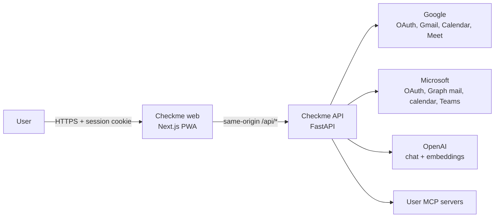

## 2. Containers

Processes and stores at runtime.

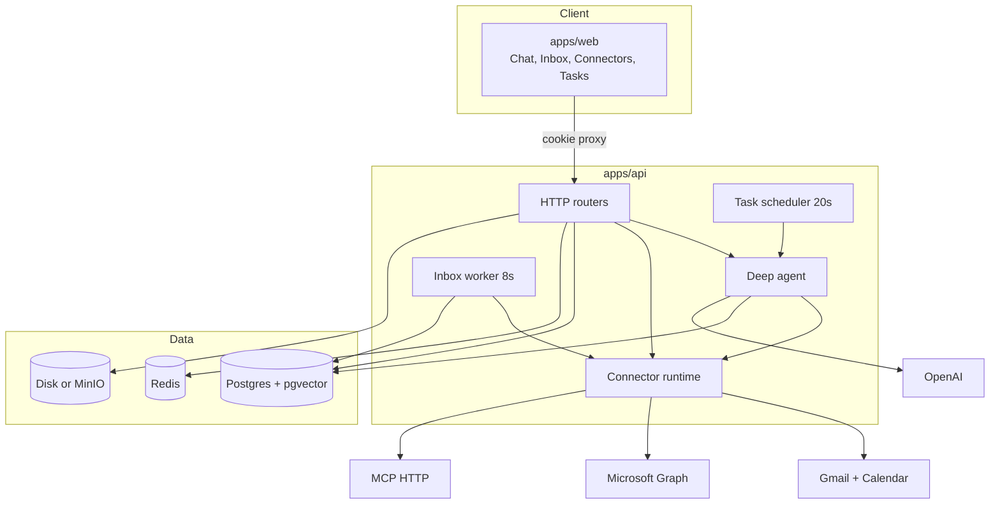

## 3. Local vs Render

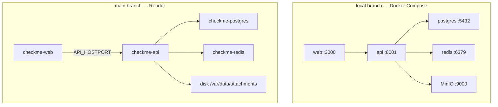

## 4. Request path

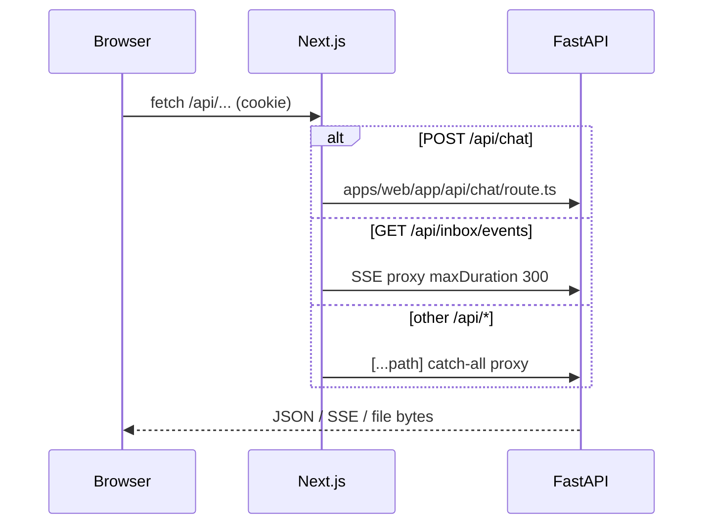

## 5. Sign-in

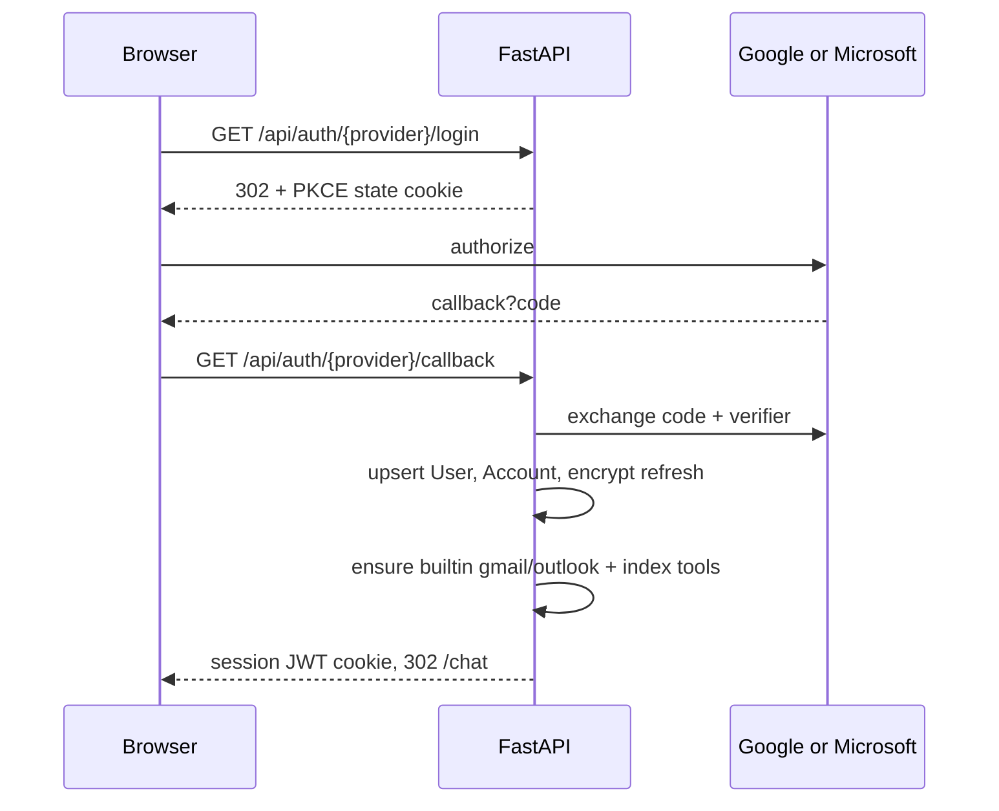

## 6. Chat agent

The model never receives the full MCP catalog. It uses a small harness, then `call_tool`.

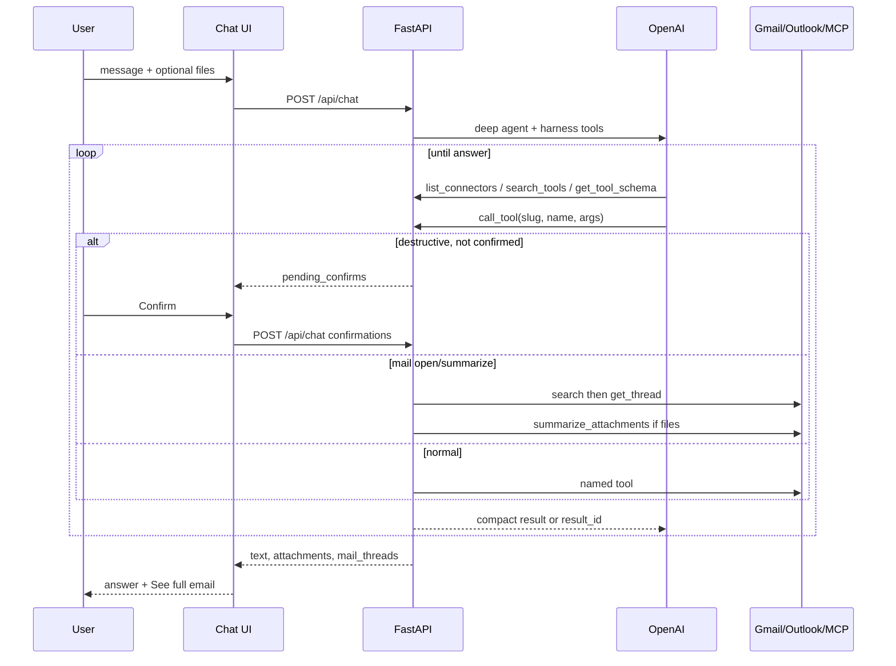

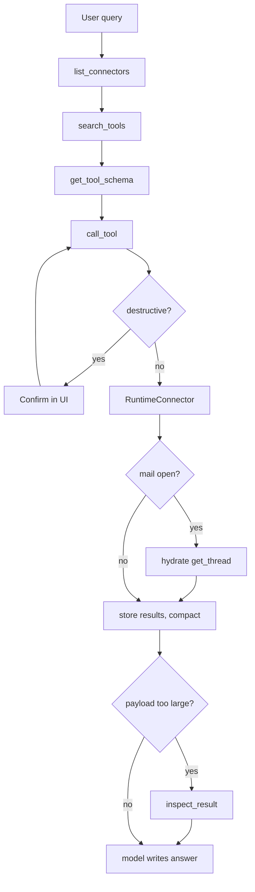

## 7. Outlook / Gmail full thread

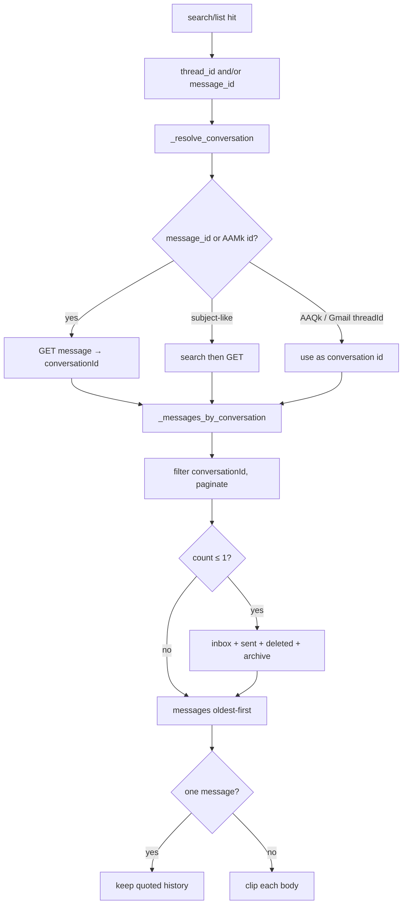

## 8. Inbox realtime

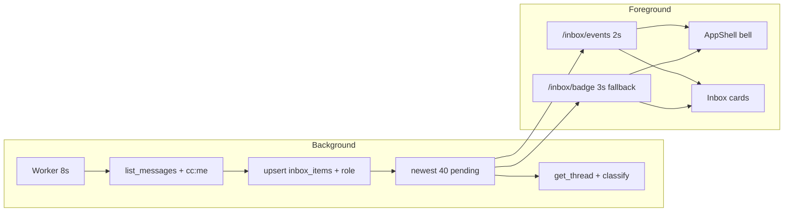

## 9. Files

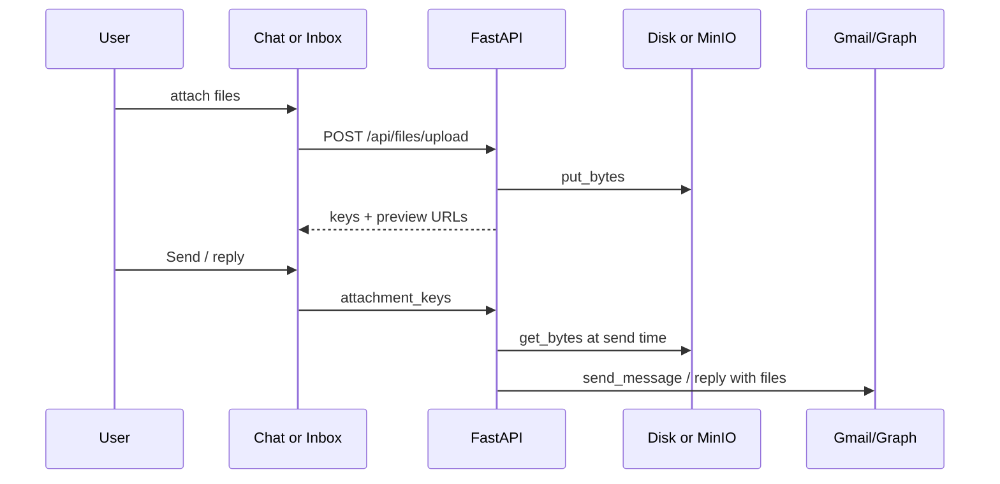

## 10. Scheduler

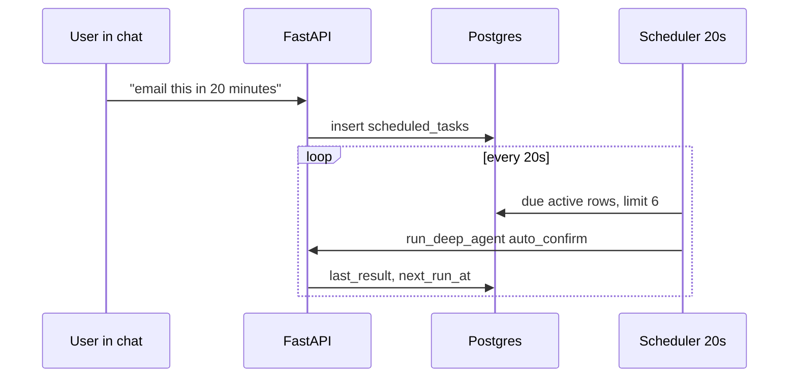

## 11. Data model

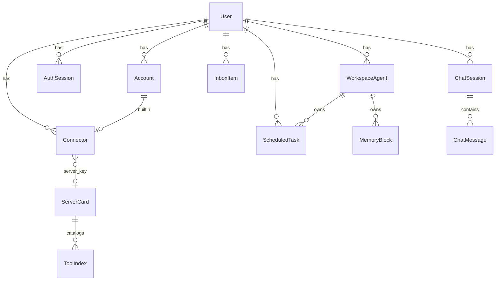

## 12. Security boundaries

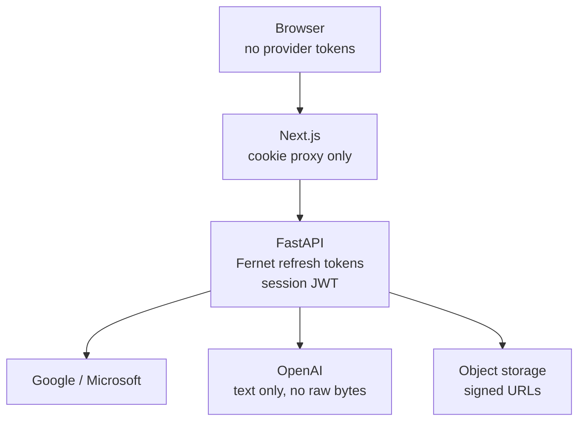

## 13. To, Cc, and Bcc

Mail on **Cc** (and **Bcc** when the mailbox still delivers it) is ingested, notified, triaged, and briefed. Send can add extra people.

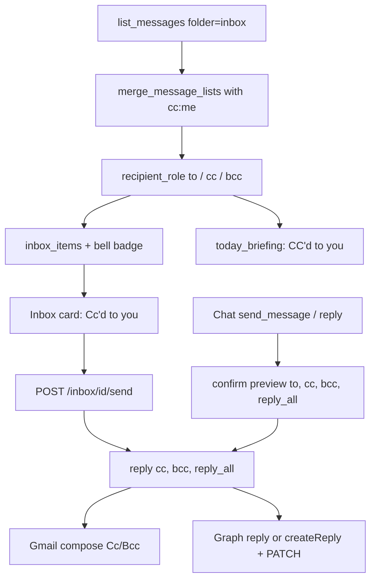
